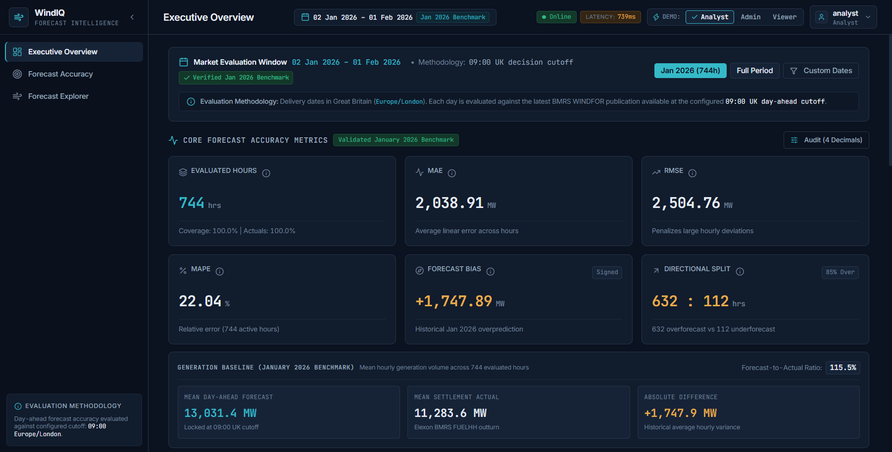
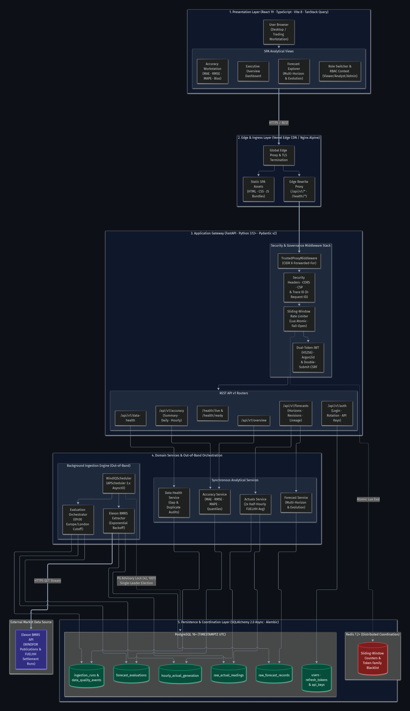
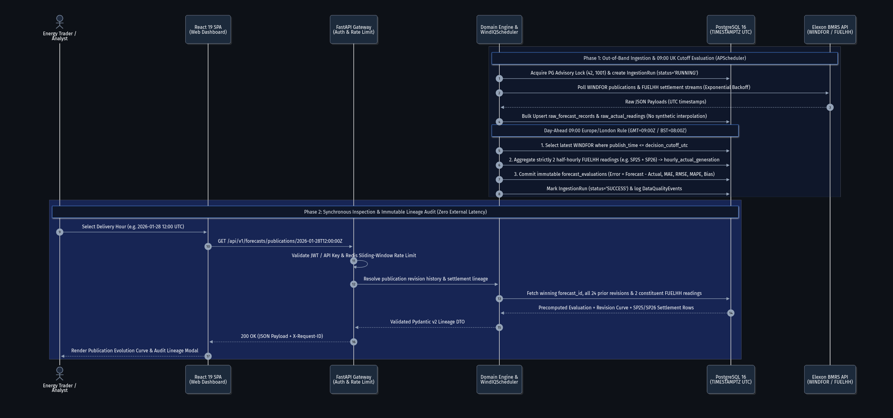

# WindIQ — UK Wind Generation Intelligence & Forecast Accuracy Platform

**WindIQ** is an enterprise analytics and day-ahead forecast accuracy intelligence platform evaluating national wind generation across Great Britain using Elexon BMRS API data (`WINDFOR` and `FUELHH`).

Built for electricity utility trading, power generation scheduling, and energy risk management desks.



---

## Live Cloud Deployments

* **Web Application (Vercel)**: [https://windiq-org.vercel.app](https://windiq-org.vercel.app)
* **Backend API Gateway (Render)**: [https://windiq.onrender.com](https://windiq.onrender.com)
* **API Documentation (Swagger UI)**: [https://windiq.onrender.com/docs](https://windiq.onrender.com/docs)
* **API Liveness Probe**: [https://windiq.onrender.com/health/live](https://windiq.onrender.com/health/live)

---

## Architecture & Technology Stack

* **Backend**: Python 3.12+, FastAPI, SQLAlchemy 2.0 Async, PostgreSQL 16+, Redis 7, Alembic, Pydantic v2.
* **Frontend**: React 19, TypeScript, Vite 8, Tailwind CSS, Recharts, Lucide React, TanStack Query.
* **Security & Auth**: Argon2id hashing, dual-token JWT family rotation, SameSite CSRF cookies, Redis sliding-window rate limiting.
* **Infrastructure**: Multi-stage Docker builds, Nginx Alpine, Docker Compose.
* **Market Rules**: Strict **09:00 Europe/London decision cutoff** for day-ahead market evaluations.

### System Architecture



### Data Evaluation & Settlement Lineage Workflow



---

## Quickstart with Docker Compose

To boot the entire full-stack system locally (PostgreSQL + Redis + FastAPI Backend + React Frontend):

```bash
# 1. Clone repository and copy environment defaults
cp .env.example .env

# 2. Build and start all containers
docker compose up -d --build

# 3. Check container status
docker compose ps
```

### Local Services & Endpoints
* **Web Application**: [http://localhost:3000](http://localhost:3000)
* **API Documentation (Swagger UI)**: [http://localhost:8001/docs](http://localhost:8001/docs)
* **Backend Health Check**: [http://localhost:8001/health/live](http://localhost:8001/health/live)
* **Frontend Health Check**: [http://localhost:3000/health](http://localhost:3000/health)

---

## Local Frontend Development

```bash
cd frontend

# Install dependencies
npm install

# Start Vite dev server on port 3000
npm run dev

# Run TypeScript type check
npm run typecheck

# Run linter
npm run lint

# Run unit & integration test suite
npm test

# Build production bundle
npm run build
```

---

## Verified January 2026 Analytical Benchmark

The platform reconciles 100% against the verified 744-hour January 2026 benchmark:

| Metric | Benchmark Value |
|---|---:|
| **Evaluated Hours** | 744 hrs |
| **Forecast Coverage** | 100.0% |
| **Actual Completeness** | 100.0% |
| **Mean Absolute Error (MAE)** | 2,038.9126 MW |
| **Root Mean Square Error (RMSE)** | 2,504.7587 MW |
| **Mean Absolute Percentage Error (MAPE)** | 22.0446% |
| **Forecast Bias** | +1,747.8871 MW |
| **Overforecast Hours** | 632 hrs (84.9%) |
| **Underforecast Hours** | 112 hrs (15.1%) |
| **Zero Error Hours** | 0 hrs |

---

## Documentation & Engineering Specifications

* [Backend Architecture & System Design](docs/backend_architecture.md)
* [Database Schema & Entity Relationship Specification](docs/database_schema.md)
* [REST API Contract Specification](docs/api_contract.md)
* [Render Production Deployment Guide](docs/render_deployment_guide.md)
* [January 2026 Forecast Accuracy Audit Summary](reports/january_audit_summary.md)
* [Forensic Data Pipeline & Integrity Audit Report](reports/final_integrity_audit.md)

