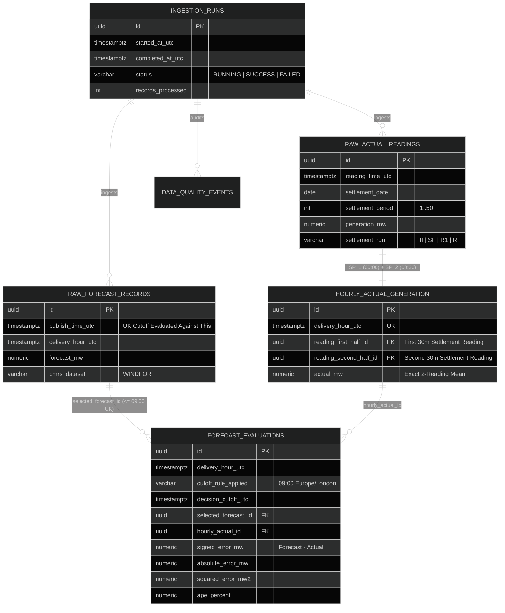

# WindIQ — Backend Architecture Design

**Document Version**: 2.0.0  
**Status**: APPROVED DESIGN SPECIFICATION  
**Author**: Senior Backend Architect & Energy-Data Platform Engineer  
**Target Stack**: Python 3.12+, FastAPI, PostgreSQL 16+, SQLAlchemy 2.0 (AsyncIO), Pydantic v2, Alembic, Pytest, Docker  

---

## 1. Executive Summary & Architectural Goals

WindIQ is an enterprise analytics platform evaluating day-ahead wind generation forecast accuracy across Great Britain using Elexon BMRS API data. 

The backend architecture is structured as a **modular monolith** adhering to Clean Architecture and Domain-Driven Design (DDD) principles. It guarantees:
1. **Mathematical Reproducibility**: Exact recalculation of MAE, RMSE, MAPE, and signed forecast bias against validated benchmark figures.
2. **Immutable Traceability**: Every evaluation metric is bidirectionally linked to its selected forecast publication record and its aggregated hourly actual record (which in turn links to its two specific half-hourly settlement readings).
3. **Decoupled Workloads**: External BMRS ingestion and heavy data aggregation operate out-of-band, preventing dashboard API latency degradation.
4. **Timezone Rigor**: Dynamic `Europe/London` cutoff management converted to UTC, preventing daylight saving distortions without hardcoded offsets.
5. **No Synthetic Data**: Strict operational refusal to interpolate missing readings or manufacture forecast values.

---

## 2. System Architecture (Full-Stack & Cloud Topology)

WindIQ enforces clean domain boundaries with an asynchronous background orchestration engine, decoupled read services, dual-token JWT / CSRF security middleware, atomic sliding-window rate limiting via Redis 7, single-leader scheduling via PostgreSQL advisory locks `(42, 1001)`, and strict relational data lineage.

```mermaid
%%{init: {'theme': 'dark', 'themeVariables': { 'primaryColor': '#1e293b', 'primaryTextColor': '#f8fafc', 'primaryBorderColor': '#475569', 'lineColor': '#94a3b8', 'secondaryColor': '#0f172a', 'tertiaryColor': '#1e1b4b'}}}%%
flowchart TB
    %% ─────────────────────────────────────────────────────────────
    %% 1. PRESENTATION LAYER
    %% ─────────────────────────────────────────────────────────────
    subgraph Presentation ["1. Presentation Layer (React 19 · TypeScript · Vite 8 · TanStack Query)"]
        direction LR
        Browser["User Browser<br/>(Desktop / Trading Workstation)"]
        subgraph UI_Views ["SPA Analytical Views"]
            direction LR
            V_Exec["Executive Overview<br/>Dashboard"]
            V_Exp["Forecast Explorer<br/>(Multi-Horizon & Evolution)"]
            V_Acc["Accuracy Workstation<br/>(MAE · RMSE · MAPE · Bias)"]
            V_RBAC["Role Switcher &<br/>RBAC Context (Viewer/Analyst/Admin)"]
        end
        Browser --> UI_Views
    end

    %% ─────────────────────────────────────────────────────────────
    %% 2. EDGE & INGRESS LAYER
    %% ─────────────────────────────────────────────────────────────
    subgraph Edge ["2. Edge & Ingress Layer (Vercel Edge CDN / Nginx Alpine)"]
        direction LR
        CDN["Global Edge Proxy & TLS Termination"]
        Static["Static SPA Assets<br/>(HTML · CSS · JS Bundles)"]
        Rewrite["Edge Rewrite Proxy<br/>(/api/v1/* · /health/*)"]
        CDN --> Static
        CDN --> Rewrite
    end

    %% ─────────────────────────────────────────────────────────────
    %% 3. APPLICATION GATEWAY (FASTAPI)
    %% ─────────────────────────────────────────────────────────────
    subgraph Gateway ["3. Application Gateway (FastAPI · Python 3.12+ · Pydantic v2)"]
        direction TB
        subgraph Security_MW ["Security & Governance Middleware Stack"]
            direction LR
            MW_Proxy["TrustedProxyMiddleware<br/>(CIDR X-Forwarded-For)"]
            MW_Headers["Security Headers · CORS · CSP<br/>& Trace ID (X-Request-ID)"]
            MW_Rate["Sliding-Window Rate Limiter<br/>(Lua Atomic · Fail-Open)"]
            MW_Auth["Dual-Token JWT (HS256) · Argon2id<br/>& Double-Submit CSRF"]
            MW_Proxy --> MW_Headers --> MW_Rate --> MW_Auth
        end

        subgraph Routers ["REST API v1 Routers"]
            direction LR
            R_Over["/api/v1/overview"]
            R_Fc["/api/v1/forecasts<br/>(Horizons · Revisions · Lineage)"]
            R_Acc["/api/v1/accuracy<br/>(Summary · Daily · Hourly)"]
            R_DQ["/api/v1/data-health"]
            R_Auth["/api/v1/auth<br/>(Login · Rotation · API Keys)"]
            R_Health["/health/live &<br/>/health/ready"]
        end

        Security_MW --> Routers
    end

    %% ─────────────────────────────────────────────────────────────
    %% 4. DOMAIN SERVICES & BACKGROUND ORCHESTRATION
    %% ─────────────────────────────────────────────────────────────
    subgraph Domain ["4. Domain Services & Out-of-Band Orchestration"]
        direction LR
        subgraph Read_Services ["Synchronous Analytical Services"]
            direction TB
            S_Acc["Accuracy Service<br/>(MAE · RMSE · MAPE · Quantiles)"]
            S_Fc["Forecast Service<br/>(Multi-Horizon & Evolution)"]
            S_Act["Actuals Service<br/>(2x Half-Hourly FUELHH Avg)"]
            S_DQ["Data Health Service<br/>(Gap & Duplicate Audits)"]
        end

        subgraph BG_Engine ["Background Ingestion Engine (Out-of-Band)"]
            direction TB
            Scheduler["WindIQScheduler<br/>(APScheduler 3.x AsyncIO)"]
            Eval_Orch["Evaluation Orchestrator<br/>(09:00 Europe/London Cutoff)"]
            BMRS_Client["Elexon BMRS Extractor<br/>(Exponential Backoff)"]
            Scheduler --> Eval_Orch
            Scheduler --> BMRS_Client
        end
    end

    %% ─────────────────────────────────────────────────────────────
    %% 5. EXTERNAL DATA SOURCES
    %% ─────────────────────────────────────────────────────────────
    subgraph External ["External Market Data Source"]
        Elexon["Elexon BMRS API<br/>(WINDFOR Publications & FUELHH Settlement Runs)"]
    end

    %% ─────────────────────────────────────────────────────────────
    %% 6. PERSISTENCE & DISTRIBUTED COORDINATION
    %% ─────────────────────────────────────────────────────────────
    subgraph Persistence ["5. Persistence & Coordination Layer (SQLAlchemy 2.0 Async · Alembic)"]
        direction LR
        subgraph PG ["PostgreSQL 16+ (TIMESTAMPTZ UTC)"]
            direction LR
            T_RawFc[("raw_forecast_records")]
            T_RawAct[("raw_actual_readings")]
            T_HrAct[("hourly_actual_generation")]
            T_Eval[("forecast_evaluations")]
            T_Ops[("ingestion_runs &<br/>data_quality_events")]
            T_Auth[("users · refresh_tokens<br/>& api_keys")]
        end

        subgraph Redis_Cluster ["Redis 7.2+ (Distributed Coordination)"]
            R_Store[("Sliding-Window Counters &<br/>Token Family Blacklist")]
        end
    end

    %% ─────────────────────────────────────────────────────────────
    %% CROSS-LAYER CONNECTIONS
    %% ─────────────────────────────────────────────────────────────
    UI_Views ==>|"HTTPS / REST"| CDN
    Rewrite ==> MW_Proxy
    MW_Rate -.->|"Atomic Lua Eval"| R_Store

    R_Over & R_Acc --> S_Acc
    R_Fc --> S_Fc
    R_Fc --> S_Act
    R_DQ --> S_DQ
    R_Auth --> T_Auth

    BMRS_Client ==>|"HTTPS GET Stream"| Elexon
    Scheduler -.->|"PG Advisory Lock (42, 1001)<br/>Single-Leader Election"| PG

    S_Acc --> T_Eval
    S_Fc --> T_RawFc
    S_Act --> T_HrAct & T_RawAct
    S_DQ --> T_Ops

    BMRS_Client --> T_RawFc & T_RawAct
    Eval_Orch --> T_HrAct & T_Eval & T_Ops

    %% Styling
    classDef layer fill:#0f172a,stroke:#334155,stroke-width:1.5px,color:#f8fafc;
    classDef subbox fill:#1e293b,stroke:#475569,stroke-width:1px,color:#e2e8f0;
    classDef db fill:#064e3b,stroke:#10b981,stroke-width:1.5px,color:#ecfdf5;
    classDef redis fill:#7f1d1d,stroke:#ef4444,stroke-width:1.5px,color:#fef2f2;
    classDef ext fill:#312e81,stroke:#6366f1,stroke-width:1.5px,color:#e0e7ff;

    class Presentation,Edge,Gateway,Domain,Persistence layer;
    class UI_Views,Security_MW,Routers,Read_Services,BG_Engine subbox;
    class T_RawFc,T_RawAct,T_HrAct,T_Eval,T_Ops,T_Auth db;
    class R_Store redis;
    class Elexon ext;
```



---

## 3. Layered Module Structure & Responsibilities

The codebase layout maps cleanly to the required directory hierarchy:

```
backend/
├── app/
│   ├── main.py                     # FastAPI application factory, lifespan, and middleware registration
│   ├── core/
│   │   ├── config.py               # Pydantic Settings: environment vars, DB pool, cutoff config
│   │   ├── logging.py              # Structured JSON logging with trace context
│   │   └── timezone.py             # Timezone conversion utilities using Python standard zoneinfo
│   ├── api/
│   │   ├── deps.py                 # Dependency injection (AsyncSession, services)
│   │   └── v1/
│   │       ├── overview.py         # GET /api/v1/overview
│   │       ├── forecasts.py        # GET /api/v1/forecasts
│   │       ├── accuracy.py         # GET /api/v1/accuracy/{summary, daily, hourly}
│   │       └── data_health.py      # GET /api/v1/data-health
│   ├── models/                     # SQLAlchemy 2.0 Declarative ORM models
│   │   ├── base.py
│   │   ├── forecast.py             # RawForecastRecord
│   │   ├── actual.py               # RawActualReading, HourlyActualGeneration
│   │   ├── evaluation.py           # ForecastEvaluation
│   │   ├── ingestion.py            # IngestionRun
│   │   └── data_quality.py         # DataQualityEvent
│   ├── schemas/                    # Pydantic v2 validation and serialization schemas
│   │   ├── common.py               # Pagination, Error envelopes, Time range filters
│   │   ├── overview.py
│   │   ├── forecast.py
│   │   ├── accuracy.py
│   │   └── data_health.py
│   ├── repositories/               # Direct asynchronous SQL queries (no leaked ORM logic)
│   │   ├── base.py                 # Generic CRUD & pagination interfaces
│   │   ├── forecast_repository.py
│   │   ├── actuals_repository.py
│   │   ├── evaluation_repository.py
│   │   └── data_quality_repository.py
│   ├── services/                   # Business logic and domain computation
│   │   ├── forecast_service.py     # Cutoff evaluation and latest publication resolution
│   │   ├── actuals_service.py      # Strict 2-reading half-hourly average verification
│   │   ├── accuracy_service.py     # Pure arithmetic: MAE, RMSE, MAPE, Bias calculation
│   │   ├── data_quality_service.py # Health metrics, gap identification, spacing checks
│   │   └── ingestion_service.py    # Ingestion orchestration and transaction boundaries
│   └── data_pipeline/              # Preserved extraction engine migrated from Phase 1
│       ├── config.py
│       ├── extractor.py
│       ├── normalizer.py
│       └── selector.py
├── migrations/                     # Alembic migration scripts
│   ├── env.py
│   ├── script.py.mako
│   └── versions/
├── tests/                          # Pytest test suite
│   ├── conftest.py                 # Async DB fixtures, Testcontainers / SQLite mock
│   ├── test_api/                   # Route tests using httpx.AsyncClient
│   ├── test_services/              # Domain service unit tests
│   ├── test_repositories/          # Repository integration tests
│   └── test_regression/            # Verified January 2026 regression benchmarks
├── Dockerfile                      # Production multi-stage Docker build
├── docker-compose.yml              # Local development stack (App + PostgreSQL)
└── requirements.txt                # Pinned production dependencies
```

---

## 4. End-to-End Data Flow & Ingestion Decoupling

External API interactions and heavy analytical evaluations operate strictly out-of-band, guaranteeing sub-50ms read latency on analytical endpoints:

```mermaid
%%{init: {'theme': 'dark', 'themeVariables': { 'actorBkg': '#1e293b', 'actorBorder': '#64748b', 'actorTextColor': '#f8fafc', 'signalColor': '#94a3b8', 'signalTextColor': '#f8fafc', 'noteBkgColor': '#0f172a', 'noteBorderColor': '#3b82f6', 'noteTextColor': '#e2e8f0'}}}%%
sequenceDiagram
    autonumber
    actor Trader as Energy Trader /<br/>Analyst
    participant UI as React 19 SPA<br/>(Web Dashboard)
    participant API as FastAPI Gateway<br/>(Auth & Rate Limit)
    participant Domain as Domain Engine &<br/>WindIQScheduler
    participant DB as PostgreSQL 16<br/>(TIMESTAMPTZ UTC)
    participant BMRS as Elexon BMRS API<br/>(WINDFOR / FUELHH)

    rect rgb(15, 23, 42)
        Note over Domain, BMRS: Phase 1: Out-of-Band Ingestion & 09:00 UK Cutoff Evaluation (APScheduler)
        Domain->>DB: Acquire PG Advisory Lock (42, 1001) & create IngestionRun (status='RUNNING')
        Domain->>BMRS: Poll WINDFOR publications & FUELHH settlement streams (Exponential Backoff)
        BMRS-->>Domain: Raw JSON Payloads (UTC timestamps)
        Domain->>DB: Bulk Upsert raw_forecast_records & raw_actual_readings (No synthetic interpolation)

        Note over Domain, DB: Day-Ahead 09:00 Europe/London Rule (GMT=09:00Z / BST=08:00Z)
        Domain->>DB: 1. Select latest WINDFOR where publish_time <= decision_cutoff_utc
        Domain->>DB: 2. Aggregate strictly 2 half-hourly FUELHH readings (e.g. SP25 + SP26) -> hourly_actual_generation
        Domain->>DB: 3. Commit immutable forecast_evaluations (Error = Forecast - Actual, MAE, RMSE, MAPE, Bias)
        Domain->>DB: Mark IngestionRun (status='SUCCESS') & log DataQualityEvents
    end

    rect rgb(23, 37, 84)
        Note over Trader, DB: Phase 2: Synchronous Inspection & Immutable Lineage Audit (Zero External Latency)
        Trader->>UI: Select Delivery Hour (e.g. 2026-01-28 12:00 UTC)
        UI->>API: GET /api/v1/forecasts/publications/2026-01-28T12:00:00Z
        API->>API: Validate JWT / API Key & Redis Sliding-Window Rate Limit
        API->>Domain: Resolve publication revision history & settlement lineage
        Domain->>DB: Fetch winning forecast_id, all 24 prior revisions & 2 constituent FUELHH readings
        DB-->>Domain: Precomputed Evaluation + Revision Curve + SP25/SP26 Settlement Rows
        Domain-->>API: Validated Pydantic v2 Lineage DTO
        API-->>UI: 200 OK (JSON Payload + X-Request-ID)
        UI-->>Trader: Render Publication Evolution Curve & Audit Lineage Modal
    end
```



### 4.1 Database Entity-Relationship & Lineage Schema

To guarantee Requirement #2 (Immutable Traceability), every evaluation record stores relational foreign keys directly to its selected winning forecast publication and its hourly actual generation record (which links to the two specific half-hourly settlement readings):



---

## 5. Timezone & Decision Cutoff Architecture

* **Database Storage**: All timestamps are stored in PostgreSQL as `TIMESTAMPTZ` (UTC).
* **Cutoff Dynamic Resolution**:
  The decision cutoff rule is configured via `cutoff_timezone_name` (`Europe/London`) and `cutoff_time` (`09:00:00`).
  ```python
  from datetime import date, datetime, timezone
  from zoneinfo import ZoneInfo

  def calculate_cutoff_utc(decision_date: date, local_time_str: str, tz_name: str) -> datetime:
      tz = ZoneInfo(tz_name)
      t = datetime.strptime(local_time_str, "%H:%M:%S").time()
      local_dt = datetime.combine(decision_date, t, tzinfo=tz)
      return local_dt.astimezone(timezone.utc)
  ```
  In January (GMT), `09:00 Europe/London` equates to `09:00:00Z`. In July (BST), `09:00 Europe/London` dynamically converts to `08:00:00Z` without code changes or risk of off-by-one errors.
* **Traceable Cutoff Attribution**:
  The evaluation record stores both `decision_cutoff_utc` and `cutoff_rule_applied` (e.g., `'09:00 Europe/London'`). This allows analysts to test alternative cutoffs (e.g., 07:00, 11:00) side-by-side in the same database without data collision.

---

## 6. Error Handling & Structured Logging

### Structured JSON Logging
All application logs are emitted in JSON format containing:
* `timestamp` (ISO 8601 UTC)
* `level` (`INFO`, `WARNING`, `ERROR`)
* `request_id` (UUID generated by ASGI middleware or propagated from `X-Request-ID`)
* `module` / `logger` name
* `message`
* Contextual metadata (e.g. `delivery_date`, `execution_time_ms`, `http_status`)

### Standardized Error Envelope
When an error occurs, the API returns a structured RFC 7807 problem response:
```json
{
  "error": {
    "code": "RESOURCE_NOT_FOUND",
    "message": "No forecast evaluations found for delivery date 2026-02-15",
    "details": {
      "requested_date": "2026-02-15",
      "available_range": ["2026-01-02", "2026-02-01"]
    },
    "request_id": "c1f7b68a-7b3b-48cf-9a99-cf33a1e944b2",
    "timestamp": "2026-11-04T12:00:00Z"
  }
}
```

---

## 7. Authentication, Session Management & RBAC

* **Password Security**: Passwords hashed using standard Argon2id with cryptographically random salts.
* **Dual-Token JWT Architecture**:
  * **Short-Lived Access Tokens**: Signed with HS256, 15-minute validity, carried in `Authorization: Bearer <token>` or returned in response payload.
  * **Secure HTTP-Only Refresh Tokens**: 7-day validity, bound to single-flight token family rotation stored in PostgreSQL (`refresh_tokens` table).
  * **Theft Detection & Family Revocation**: If an invalidated refresh token is reused, the entire token family is immediately revoked, forcing all active sessions to terminate.
* **Double-Submit CSRF Hardening**: Stateful mutation requests (`POST`, `PUT`, `DELETE`, `PATCH`) require cryptographic `X-CSRF-Token` headers matched against secure SameSite cookies scoped to `/`.
* **Role-Based Access Control (RBAC)**:
  * **Viewer**: Read-only access to standard analytical overview and benchmark summaries.
  * **Analyst**: Deep access to publication revisions, multi-horizon analytics, lineage modals, and CSV exports.
  * **Admin**: Unrestricted analytical access, API key provisioning/revocation, ingestion triggers, and system audit logs.

---

## 8. Distributed Rate Limiting & Production API Security

* **Atomic Sliding-Window Rate Limiting**: Enforced via Redis 7.x Lua scripts across distributed API worker processes:
  * **Login Endpoint**: 5 attempts per 60 seconds per IP with account-level lockouts.
  * **Analytics Endpoints**: 60 requests per minute per IP/API-key for public viewers; 300 requests per minute for authenticated analysts.
  * **Fail-Open Resilience**: If Redis is temporarily unreachable in demo environments, rate limiting fails open gracefully with structured warnings rather than returning 500 errors.
* **Reverse Proxy Header Trust**: Configured `TrustedProxyMiddleware` parses `X-Forwarded-For` strictly against configured proxy CIDR blocks (Docker bridge, Render/Vercel edges), preventing IP spoofing.
* **Security Headers & Tracing**: All responses enforce `X-Content-Type-Options: nosniff`, `X-Frame-Options: DENY`, `Referrer-Policy: strict-origin-when-cross-origin`, modern Content Security Policies, and trace IDs (`X-Request-ID`).

---

## 9. Background Ingestion & Scheduling (`WindIQScheduler`)

* **Engine**: Built on `APScheduler 3.x` with AsyncIO event loop integration.
* **Leader Election via PostgreSQL Advisory Locks**:
  * Prevents concurrent multi-container execution race conditions during horizontal scaling.
  * Uses deterministic advisory lock key `(42, 1001)` acquired on startup and released gracefully on shutdown.
* **Cron & Interval Cadences**:
  * **Day-Ahead Ingestion**: Evaluates rolling dates where the 09:00 Europe/London cutoff has elapsed.
  * **Settlement Actuals Ingestion**: Polls BMRS `FUELHH` runs at half-hourly intervals with lookback windows to capture settlement runs (II, SF, R1, RF).
  * **Data Quality Audits**: Hourly automated audits verifying sequence gaps, negative generation, and publication duplicates.

---

## 10. Testing Strategy & Quality Gates

The backend test suite uses `pytest` and `pytest-asyncio` organized into four distinct test layers:

1. **Unit Tests (`tests/test_services/`)**:
   * Pure domain logic tests: verify MAE, RMSE, MAPE, and bias formulas against synthetic edge cases (e.g. zero actuals, symmetric errors).
   * Timezone conversion unit tests verifying GMT/BST edge cases.
2. **Repository & Database Integration Tests (`tests/test_repositories/`)**:
   * Tested against PostgreSQL (via Testcontainers or isolated local test database).
   * Verifies unique constraints: rejection of duplicate `(publish_time, delivery_hour)` or duplicate FUELHH timestamps.
   * Verifies foreign key cascades and relational integrity.
3. **API Contract Tests (`tests/test_api/`)**:
   * Use FastAPI's `httpx.AsyncClient`.
   * Verify HTTP status codes, pagination headers, query parameter validation, and JSON response schemas against `api_contract.md`.
4. **Regression Verification Tests (`tests/test_regression/`)**:
   * Asserts that loading the January 2026 database results produces exact matching values for the verified benchmark:
     * Jan 2, 2026 14:00 UTC sample: Forecast = 17,712 MW, Actual = 15,513 MW, Error = +2,199 MW, APE = 14.18%.
     * January overall: MAE = 2,038.91 MW, RMSE = 2,504.76 MW, MAPE = 22.04%, Bias = +1,747.89 MW across 744 valid hours.

