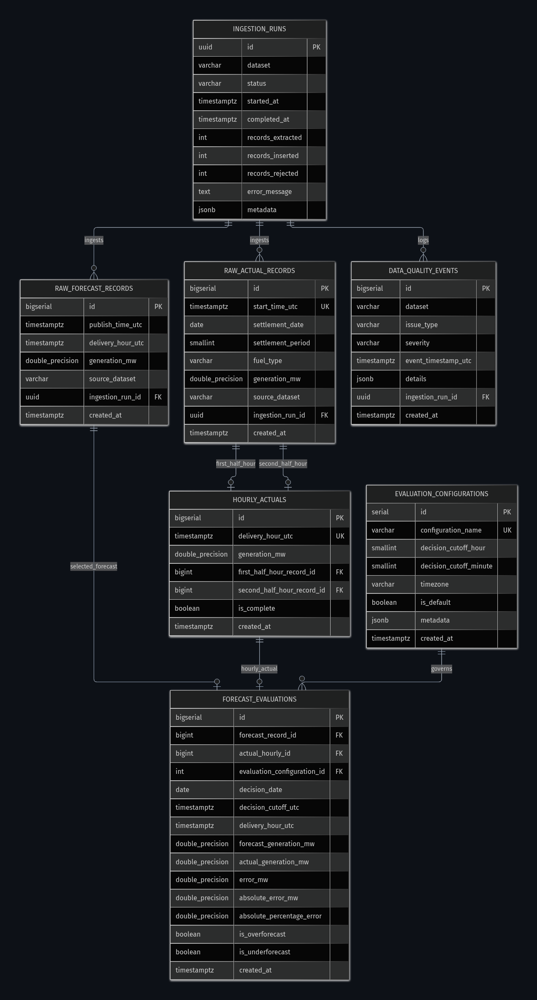

# WindIQ — Database Schema Specification

**Document Version**: 2.2.0  
**Status**: IMPLEMENTED & TESTED (Phase 2.2)  
**Database Engine**: PostgreSQL 16+  
**ORM**: SQLAlchemy 2.0 Async (Mapped Types, Declarative Base)  
**Migration Tool**: Alembic (Asyncpg engine)  

---

## 1. Schema Overview & Relational Integrity

The WindIQ schema is designed to enforce relational integrity, prevent duplicate records, and preserve full data lineage from raw Elexon BMRS streams to high-level accuracy KPIs.

### Key Architectural Constraints
1. **Preservation of Forecast History**: WINDFOR records in `raw_forecast_records` are uniquely identified by `(publish_time_utc, delivery_hour_utc)`. Multiple publication cycles for the same delivery hour are preserved without collision or overwrite.
2. **Strict Half-Hourly Lineage**: Every row in `hourly_actuals` references exactly two distinct half-hourly records in `raw_actual_records` (`first_half_hour_record_id` and `second_half_hour_record_id`) via foreign keys, enforced by check constraint `chk_hourly_actuals_distinct_readings`.
3. **Traceable Evaluation Lineage**: Every row in `forecast_evaluations` references the specific selected `raw_forecast_records.id`, the `hourly_actuals.id`, and the applied `evaluation_configurations.id`.
4. **Configurable Decision Cutoffs**: Evaluations are uniquely identified by composite key `(delivery_hour_utc, evaluation_configuration_id)`. Multiple cutoff rules (e.g., 09:00 vs 07:00 Europe/London) coexist without collision.
5. **Historical Protection**: Historical forecast and actual records cannot be accidentally deleted if referenced by evaluations or hourly aggregations (`ON DELETE RESTRICT`).

---

## 2. Entity-Relationship Diagram

The schema enforces strict relational traceability across forecast publications, settlement actuals, hourly aggregation, and immutable evaluation records:

* **Raw Forecast Records** (`raw_forecast_records`): Preserves every publication cycle from WINDFOR.
* **Raw Actual Records** (`raw_actual_records`): Stores half-hourly FUELHH settlement outturns.
* **Hourly Actuals** (`hourly_actuals`): Aggregates exactly two distinct half-hourly readings (`first_half_hour_record_id` + `second_half_hour_record_id`).
* **Evaluation Configurations** (`evaluation_configurations`): Governs the decision cutoff rules (e.g., `09:00 Europe/London`).
* **Forecast Evaluations** (`forecast_evaluations`): Immutable evaluation linking the winning forecast publication to the corresponding hourly actual record under the applied configuration.



---

## 3. Database DDL (PostgreSQL 16+)

```sql
-- Enable UUID extension
CREATE EXTENSION IF NOT EXISTS "uuid-ossp";

-- ============================================================================
-- 1. Ingestion Runs Table
-- ============================================================================
CREATE TABLE ingestion_runs (
    id UUID PRIMARY KEY DEFAULT uuid_generate_v4(),
    dataset VARCHAR(32) NOT NULL,
    status VARCHAR(24) NOT NULL DEFAULT 'PENDING',
    started_at TIMESTAMPTZ NOT NULL,
    completed_at TIMESTAMPTZ,
    records_extracted INTEGER NOT NULL DEFAULT 0,
    records_inserted INTEGER NOT NULL DEFAULT 0,
    records_rejected INTEGER NOT NULL DEFAULT 0,
    error_message TEXT,
    metadata JSONB NOT NULL DEFAULT '{}'::jsonb,
    CONSTRAINT chk_ingestion_runs_status CHECK (status IN ('PENDING', 'RUNNING', 'SUCCESS', 'FAILED'))
);

CREATE INDEX idx_ingestion_runs_dataset_status ON ingestion_runs(dataset, status);
CREATE INDEX idx_ingestion_runs_started_at ON ingestion_runs(started_at);

-- ============================================================================
-- 2. Raw Forecast Records (WINDFOR)
-- Preserves all publication versions. Never deduplicates on delivery_hour alone.
-- ============================================================================
CREATE TABLE raw_forecast_records (
    id BIGSERIAL PRIMARY KEY,
    publish_time_utc TIMESTAMPTZ NOT NULL,
    delivery_hour_utc TIMESTAMPTZ NOT NULL,
    generation_mw DOUBLE PRECISION NOT NULL,
    source_dataset VARCHAR(32) NOT NULL DEFAULT 'WINDFOR',
    ingestion_run_id UUID REFERENCES ingestion_runs(id) ON DELETE SET NULL,
    created_at TIMESTAMPTZ NOT NULL DEFAULT CURRENT_TIMESTAMP,
    CONSTRAINT uq_raw_forecast_pub_del UNIQUE (publish_time_utc, delivery_hour_utc),
    CONSTRAINT chk_raw_forecast_generation_non_negative CHECK (generation_mw >= 0.0)
);

CREATE INDEX idx_raw_forecast_delivery_publish ON raw_forecast_records(delivery_hour_utc, publish_time_utc);
CREATE INDEX idx_raw_forecast_publish_time ON raw_forecast_records(publish_time_utc);

-- ============================================================================
-- 3. Raw Actual Records (FUELHH)
-- Half-hourly settlement readings from Elexon BMRS
-- ============================================================================
CREATE TABLE raw_actual_records (
    id BIGSERIAL PRIMARY KEY,
    start_time_utc TIMESTAMPTZ NOT NULL UNIQUE,
    settlement_date DATE NOT NULL,
    settlement_period SMALLINT NOT NULL,
    fuel_type VARCHAR(16) NOT NULL DEFAULT 'WIND',
    generation_mw DOUBLE PRECISION NOT NULL,
    source_dataset VARCHAR(32) NOT NULL DEFAULT 'FUELHH',
    ingestion_run_id UUID REFERENCES ingestion_runs(id) ON DELETE SET NULL,
    created_at TIMESTAMPTZ NOT NULL DEFAULT CURRENT_TIMESTAMP,
    CONSTRAINT uq_raw_actual_start_time UNIQUE (start_time_utc),
    CONSTRAINT chk_raw_actual_generation_non_negative CHECK (generation_mw >= 0.0),
    CONSTRAINT chk_raw_actual_settlement_period CHECK (settlement_period BETWEEN 1 AND 50)
);

CREATE INDEX idx_raw_actual_settlement ON raw_actual_records(settlement_date, settlement_period);

-- ============================================================================
-- 4. Hourly Actuals
-- Hourly values derived from exactly two half-hourly readings
-- ============================================================================
CREATE TABLE hourly_actuals (
    id BIGSERIAL PRIMARY KEY,
    delivery_hour_utc TIMESTAMPTZ NOT NULL UNIQUE,
    generation_mw DOUBLE PRECISION NOT NULL,
    first_half_hour_record_id BIGINT NOT NULL REFERENCES raw_actual_records(id) ON DELETE RESTRICT,
    second_half_hour_record_id BIGINT NOT NULL REFERENCES raw_actual_records(id) ON DELETE RESTRICT,
    is_complete BOOLEAN NOT NULL DEFAULT TRUE,
    created_at TIMESTAMPTZ NOT NULL DEFAULT CURRENT_TIMESTAMP,
    CONSTRAINT uq_hourly_actuals_delivery_hour UNIQUE (delivery_hour_utc),
    CONSTRAINT chk_hourly_actuals_distinct_readings CHECK (first_half_hour_record_id <> second_half_hour_record_id),
    CONSTRAINT chk_hourly_actuals_generation_non_negative CHECK (generation_mw >= 0.0)
);

CREATE INDEX idx_hourly_actuals_delivery_hour ON hourly_actuals(delivery_hour_utc);

-- ============================================================================
-- 5. Evaluation Configurations
-- Configurable day-ahead cutoff parameters
-- ============================================================================
CREATE TABLE evaluation_configurations (
    id SERIAL PRIMARY KEY,
    configuration_name VARCHAR(64) NOT NULL UNIQUE,
    decision_cutoff_hour SMALLINT NOT NULL,
    decision_cutoff_minute SMALLINT NOT NULL,
    timezone VARCHAR(64) NOT NULL DEFAULT 'Europe/London',
    is_default BOOLEAN NOT NULL DEFAULT FALSE,
    metadata JSONB NOT NULL DEFAULT '{}'::jsonb,
    created_at TIMESTAMPTZ NOT NULL DEFAULT CURRENT_TIMESTAMP,
    CONSTRAINT uq_eval_config_name UNIQUE (configuration_name),
    CONSTRAINT chk_eval_config_cutoff_hour CHECK (decision_cutoff_hour BETWEEN 0 AND 23),
    CONSTRAINT chk_eval_config_cutoff_minute CHECK (decision_cutoff_minute BETWEEN 0 AND 59)
);

-- ============================================================================
-- 6. Forecast Evaluations
-- Day-ahead forecast evaluations referencing exact lineage
-- ============================================================================
CREATE TABLE forecast_evaluations (
    id BIGSERIAL PRIMARY KEY,
    forecast_record_id BIGINT NOT NULL REFERENCES raw_forecast_records(id) ON DELETE RESTRICT,
    actual_hourly_id BIGINT NOT NULL REFERENCES hourly_actuals(id) ON DELETE RESTRICT,
    evaluation_configuration_id INTEGER NOT NULL REFERENCES evaluation_configurations(id) ON DELETE RESTRICT,
    decision_date DATE NOT NULL,
    decision_cutoff_utc TIMESTAMPTZ NOT NULL,
    delivery_hour_utc TIMESTAMPTZ NOT NULL,
    forecast_generation_mw DOUBLE PRECISION NOT NULL,
    actual_generation_mw DOUBLE PRECISION NOT NULL,
    error_mw DOUBLE PRECISION,
    absolute_error_mw DOUBLE PRECISION,
    absolute_percentage_error DOUBLE PRECISION,
    is_overforecast BOOLEAN,
    is_underforecast BOOLEAN,
    created_at TIMESTAMPTZ NOT NULL DEFAULT CURRENT_TIMESTAMP,
    CONSTRAINT uq_forecast_eval_delivery_config UNIQUE (delivery_hour_utc, evaluation_configuration_id),
    CONSTRAINT chk_forecast_eval_abs_error_non_negative CHECK (absolute_error_mw >= 0.0)
);

CREATE INDEX idx_forecast_evaluations_delivery ON forecast_evaluations(delivery_hour_utc);
CREATE INDEX idx_forecast_evaluations_decision_date ON forecast_evaluations(decision_date);
CREATE INDEX idx_forecast_evaluations_config_delivery ON forecast_evaluations(evaluation_configuration_id, delivery_hour_utc);

-- ============================================================================
-- 7. Data Quality Events
-- Audit log for gaps, timing drift, and ingestion warnings
-- ============================================================================
CREATE TABLE data_quality_events (
    id BIGSERIAL PRIMARY KEY,
    dataset VARCHAR(32) NOT NULL,
    issue_type VARCHAR(64) NOT NULL,
    severity VARCHAR(16) NOT NULL DEFAULT 'WARNING',
    event_timestamp_utc TIMESTAMPTZ,
    details JSONB NOT NULL DEFAULT '{}'::jsonb,
    ingestion_run_id UUID REFERENCES ingestion_runs(id) ON DELETE SET NULL,
    created_at TIMESTAMPTZ NOT NULL DEFAULT CURRENT_TIMESTAMP,
    CONSTRAINT chk_data_quality_events_severity CHECK (severity IN ('INFO', 'WARNING', 'ERROR', 'CRITICAL'))
);

CREATE INDEX idx_dq_events_dataset_issue ON data_quality_events(dataset, issue_type);
CREATE INDEX idx_dq_events_timestamp ON data_quality_events(event_timestamp_utc);
```

---

## 4. Migration Architecture with Alembic

- **Location**: `backend/migrations/`
- **Configuration**: `backend/alembic.ini`
- **Environment**: `backend/migrations/env.py` (configured with `async_engine` from SQLAlchemy 2.0 and `run_migrations_online`)
- **Initial Version**: `backend/migrations/versions/001_initial_database_schema.py`
- **Upgrade/Downgrade Lifecycle**: Fully tested; `upgrade head` creates all 7 tables and `downgrade base` drops all 7 tables and extensions safely in reverse dependency order.
