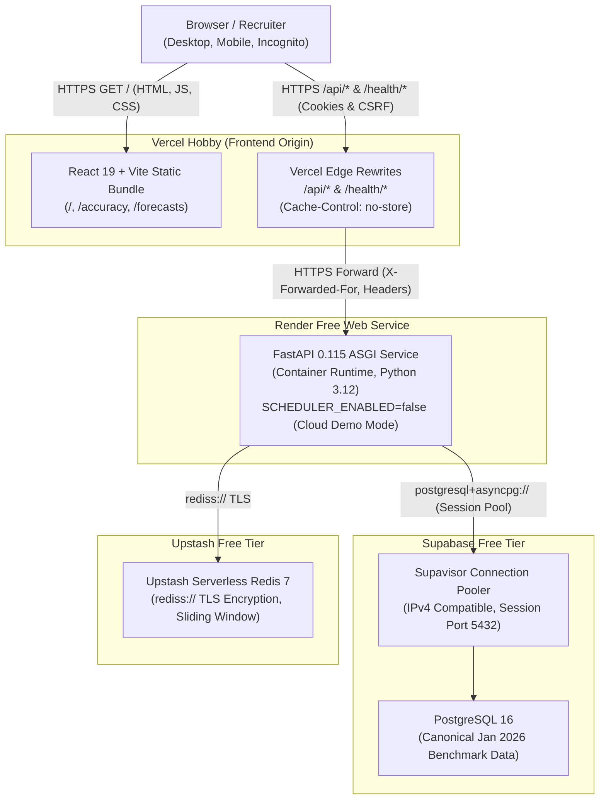

# WindIQ — Zero-Cost Cloud Deployment Guide
## Vercel (Frontend) + Render (Backend) + Supabase (PostgreSQL) + Upstash (Redis)

---

## 1. Architectural Topology

WindIQ is deployed across four zero-cost free-tier cloud platforms. The frontend acts as the single-origin ingress, proxying `/api/*` and `/health/*` calls to the FastAPI backend, preserving first-party cookies, double-submit CSRF tokens, and relative API base paths.



---

## 2. Provider Free-Tier Specifications & Resource Boundaries

| Provider | Service | Tier | Quotas & Limits | Sleep / Inactivity Policy | Cost |
|---|---|---|---|---|---|
| **Vercel** | Frontend Web Hosting | Hobby | 100 GB/mo bandwidth, 100 deploys/day | Never sleeps (Edge CDN global delivery) | **$0.00** |
| **Render** | Backend Web Service | Free Web Service | 512 MB RAM, 0.1 vCPU, 750 free hrs/mo | Sleeps after 15 min inactivity; ~30-50s cold start | **$0.00** |
| **Supabase** | Managed PostgreSQL | Free Plan | 500 MB database, 2 projects, IPv4 via Pooler | Pauses after 7 days of inactivity (unpause via 1-click) | **$0.00** |
| **Upstash** | Serverless Redis | Free Plan | 10,000 commands/day, 256 MB storage | Never sleeps; per-request billing within free tier | **$0.00** |

> [!IMPORTANT]
> **Zero-Cost Constraint**: No credit card or paid upgrade is required for any of the four tiers. Total infrastructure cost is **$0.00/month**.

---

## 3. Scheduler Adaptation: Free Cloud Demonstration Mode

In local production environments, WindIQ runs a native continuous `asyncio` scheduler with PostgreSQL advisory locking. Because Render's Free Web Service spins down after 15 minutes of inactivity, continuous background loops cannot execute while the service is sleeping.

To prevent erratic behavior or false claims:
1. **Explicit Setting**: `SCHEDULER_ENABLED=false` is injected into the Render Free Web Service environment.
2. **Honest System Status**: The data health endpoint (`/api/v1/data-health`) reports:
   ```json
   {
     "scheduler": {
       "status": "DISABLED",
       "is_leader": false,
       "enabled": false,
       "jobs": {}
     }
   }
   ```
3. **Analytical Integrity**: All analytical dashboards, KPIs, daily ledgers, and error distributions serve the pre-evaluated canonical January 2026 benchmark.
4. **Local Docker Unaffected**: Local Docker Compose defaults to `SCHEDULER_ENABLED=true` with continuous leader election.

---

## 4. Supabase Database Configuration & Migration

### 4.1 Connection Modes (IPv4 vs IPv6)
- **Supabase Direct Connection** (`db.<ref>.supabase.co:5432`) is IPv6-only on free tier in several AWS regions.
- **Supabase Supavisor Pooler** (`aws-0-<region>.pooler.supabase.com`) provides dedicated IPv4 addresses.
- **Port 5432 (Session Mode)**: Recommended. Supports standard PostgreSQL session semantics and asyncpg prepared statements.
- **Port 6543 (Transaction Mode)**: If used, WindIQ automatically detects `:6543` and configures `statement_cache_size=0` and `prepared_statement_cache_size=0` to prevent `DuplicatePreparedStatementError`.

### 4.2 SQLAlchemy Connection Pool Sizing
Configured in `backend/app/core/config.py`:
- `DB_POOL_SIZE=5` (conserves Supabase connection limits)
- `DB_MAX_OVERFLOW=10`
- `DB_POOL_TIMEOUT=30.0`
- `DB_POOL_RECYCLE=300` (recycles connections every 5 minutes to avoid stale TCP sockets)
- `DB_DISABLE_STATEMENT_CACHE=false` (automatically enabled if using port 6543)

### 4.3 Database Schema & Benchmark Initialization
The migration and benchmark verification script [`backend/scripts/init_production_benchmark.py`](file:///c:/Users/prana/Projects/WindIQ/backend/scripts/init_production_benchmark.py) executes:
```bash
# Set target cloud database URL
export DATABASE_URL="postgresql+asyncpg://postgres.<ref>:<password>@aws-0-eu-west-1.pooler.supabase.com:5432/postgres"

# Run automated initialization
python backend/scripts/init_production_benchmark.py
```
This applies Alembic migrations, creates default user accounts, unrolls January 2026 WINDFOR/FUELHH data, executes the backfill, and validates all 11 canonical benchmark metrics with 0.0000 delta.

---

## 5. Upstash Redis Configuration

### 5.1 Protocol & TLS
Upstash provides a TLS-encrypted Redis connection URI:
```text
rediss://default:<password>@<region>-<id>.upstash.io:6379
```
- `rediss://` scheme is natively recognized by `redis.asyncio.ConnectionPool.from_url`.
- Let's Encrypt / DigiCert certificates are verified automatically by the Python runtime.
- Connection limit is capped via `REDIS_MAX_CONNECTIONS=20` (well below Upstash's 100 concurrent limit).

### 5.2 Quota Conservation
- Baseline viewer rate limit: 120 RPM.
- Typical demo session consumes ~150 Redis commands.
- Free tier limit of 10,000 commands/day supports >60 full demonstration sessions per day.

---

## 6. Render FastAPI Backend Deployment

### 6.1 Web Service Specification
- **Type**: Web Service (`plan: free`)
- **Runtime**: Docker (`backend/Dockerfile`)
- **Context**: `backend`
- **DockerfilePath**: `backend/Dockerfile`
- **Port**: Bind to dynamic `PORT` via `CMD ["sh", "-c", "uvicorn app.main:app --host 0.0.0.0 --port ${PORT:-8000}"]`
- **Health Check Path**: `/health/live`

### 6.2 Render Environment Variables
```ini
APP_NAME=WindIQ Production API
APP_ENV=production
DEBUG=false
LOG_LEVEL=INFO
PORT=8000
DATABASE_URL=postgresql+asyncpg://postgres.<ref>:<password>@aws-0-eu-west-1.pooler.supabase.com:5432/postgres
DB_POOL_SIZE=5
DB_MAX_OVERFLOW=10
DB_POOL_RECYCLE=300
REDIS_URL=rediss://default:<password>@<region>.upstash.io:6379
REDIS_MAX_CONNECTIONS=20
JWT_SECRET_KEY=<generate-32-char-cryptographic-secret>
JWT_ACCESS_TOKEN_EXPIRE_MINUTES=15
JWT_REFRESH_TOKEN_EXPIRE_DAYS=7
AUTH_COOKIE_SECURE=true
AUTH_COOKIE_SAMESITE=lax
AUTH_ENFORCE=true
SCHEDULER_ENABLED=false
CORS_ORIGINS=https://<your-vercel-domain>.vercel.app
TRUSTED_PROXIES=127.0.0.1/32,::1/128,10.0.0.0/8,172.16.0.0/12
TIMEZONE=Europe/London
DECISION_CUTOFF_HOUR=9
DECISION_CUTOFF_MINUTE=0
```

---

## 7. Vercel Frontend Deployment

### 7.1 Build Settings
- **Framework Preset**: Vite
- **Root Directory**: `frontend` (or repository root `.` using root `vercel.json`)
- **Build Command**: `npm run build`
- **Output Directory**: `dist`
- **Node.js Version**: 20.x

### 7.2 Vercel Routing (`vercel.json`)
```json
{
  "$schema": "https://openapi.vercel.sh/vercel.json",
  "framework": "vite",
  "rewrites": [
    {
      "source": "/api/:path*",
      "destination": "https://<your-render-backend>.onrender.com/api/:path*"
    },
    {
      "source": "/health/:path*",
      "destination": "https://<your-render-backend>.onrender.com/health/:path*"
    },
    {
      "source": "/((?!api/|health/).*)",
      "destination": "/index.html"
    }
  ],
  "headers": [
    {
      "source": "/api/(.*)",
      "headers": [
        {
          "key": "Cache-Control",
          "value": "no-store, no-cache, must-revalidate, max-age=0"
        }
      ]
    }
  ]
}
```

### 7.3 Authentication Cookie & CSRF Forwarding
- Browser communicates with `https://<app>.vercel.app`.
- Requests to `/api/v1/auth/login` and `/api/v1/auth/refresh` return `Set-Cookie` headers from the backend.
- Because `Domain` is omitted from `set_cookie`, the browser binds `windiq_refresh_token` (`HttpOnly`, `Path=/api/v1/auth`) and `windiq_csrf_token` (`Path=/`) directly to `<app>.vercel.app`.
- Full SPA page reload (F5) on `/`, `/accuracy`, and `/forecasts` correctly presents the refresh cookie and CSRF header to restore session without CORS issues.

---

## 8. Benchmark Mathematical Reconciliation

The deployed cloud database must reconcile against the canonical benchmark:

| Metric | Target Canonical Value | Tolerance |
|---|---|---|
| **Evaluated Delivery Hours** | **744** | Exact |
| **Mean Absolute Error (MAE)** | **2,038.9126 MW** | $\pm 0.0001$ |
| **Root Mean Squared Error (RMSE)** | **2,504.7587 MW** | $\pm 0.0001$ |
| **Mean Absolute Percentage Error (MAPE)** | **22.0446%** | $\pm 0.0001$ |
| **Forecast Bias** | **+1,747.8871 MW** | $\pm 0.0001$ |
| **Overforecast Delivery Hours** | **632** | Exact |
| **Underforecast Delivery Hours** | **112** | Exact |
| **Matched Multi-Horizon Population** | **553** | Exact |
| **Matched MAE Reduction** | **34.16%** | $\pm 0.01\%$ |
| **Forward Forecast Revisions** | **13,367** | Exact |
| **Mean Absolute Forward Revision** | **343.9565 MW** | $\pm 0.0001$ |

Verification is automated via `python backend/scripts/init_production_benchmark.py`.

---

## 9. Disaster Recovery & Backup Runbook

1. **Supabase Paused Project Recovery**:
   - Supabase free projects pause after 7 days of inactivity.
   - Go to [Supabase Dashboard](https://supabase.com/dashboard) -> Select Project -> Click **Restore Project**. Restores in ~60 seconds.
2. **Render Cold Start Awareness**:
   - First visit after 15 minutes of inactivity takes ~30-50 seconds to boot.
   - Displayed in documentation: Not a failure; expected behavior of Render Free Web Services.
3. **Database Re-initialization**:
   - Canonical raw datasets (`data/raw/windfor_jan2026.json` and `data/raw/fuelhh_jan2026.json`) are checked into Git.
   - Re-running `python backend/scripts/init_production_benchmark.py` wipes and cleanly rebuilds all tables and benchmark metrics idempotently.
