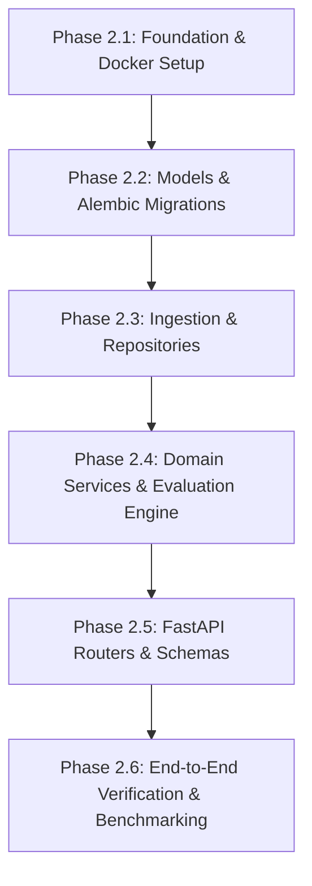

# WindIQ — Phase 2 Backend Implementation Plan

**Document Version**: 2.0.0  
**Status**: APPROVED IMPLEMENTATION ROADMAP  
**Scope**: Backend API & Data Persistence Engine  

---

## 1. Phased Execution Roadmap

The implementation is broken down into six structured, test-driven phases. Each phase concludes with an automated quality gate that must pass before progressing.

---

### Phase 2.1: Project Foundation & Container Environment
* **Goals**:
  - Establish `backend/` directory layout.
  - Create `Dockerfile` (multi-stage Python 3.12+ build) and `docker-compose.yml` (FastAPI app + PostgreSQL 16).
  - Configure `pyproject.toml` or `requirements.txt` with pinned dependencies (`fastapi`, `uvicorn`, `sqlalchemy[asyncio]`, `asyncpg`, `pydantic-settings`, `alembic`, `pytest`, `httpx`).
  - Set up `backend/app/core/config.py` using `pydantic-settings` to load environment variables.
  - Implement structured logging in `backend/app/core/logging.py`.
* **Deliverables**:
  - `backend/Dockerfile`
  - `backend/docker-compose.yml`
  - `backend/requirements.txt`
  - `backend/app/core/config.py`
  - `backend/app/core/logging.py`
* **Quality Gate 2.1**:
  - `docker compose up -d` successfully boots both Postgres and FastAPI.
  - Container health checks pass (`/health/live` returns HTTP 200).

---

### Phase 2.2: Database Models & Alembic Migrations
* **Goals**:
  - Implement SQLAlchemy 2.0 async declarative models in `backend/app/models/`:
    - `IngestionRun`
    - `RawForecastRecord`
    - `RawActualReading`
    - `HourlyActualGeneration`
    - `ForecastEvaluation`
    - `DataQualityEvent`
  - Initialize Alembic with async support (`asyncpg`).
  - Generate and verify migration scripts enforcing all unique constraints, check constraints, and composite indexes.
* **Deliverables**:
  - `backend/app/models/*.py`
  - `backend/migrations/env.py`
  - `backend/migrations/versions/001_initial_schema.py`
* **Quality Gate 2.2**:
  - `alembic upgrade head` runs cleanly against PostgreSQL.
  - `alembic downgrade base` and re-upgrade execute with zero schema errors.

---

### Phase 2.3: Ingestion Migration & Repository Layer
* **Goals**:
  - Migrate validated pipeline components from `src/data_pipeline/` into `backend/app/data_pipeline/` and `backend/app/services/ingestion_service.py`.
  - Implement async repositories in `backend/app/repositories/`:
    - `ForecastRepository`: Bulk upsert with `ON CONFLICT (publish_time_utc, delivery_hour_utc) DO NOTHING`.
    - `ActualsRepository`: Bulk upsert of raw half-hourly readings; retrieval of consecutive readings.
    - `EvaluationRepository`: Bulk upsert of forecast evaluations with cutoff filtering.
    - `DataQualityRepository`: Logging and querying data health events.
  - Create CLI command `python -m app.cli backfill-january` to load existing January 2026 data into Postgres.
* **Deliverables**:
  - `backend/app/repositories/*.py`
  - `backend/app/services/ingestion_service.py`
  - `backend/app/cli.py`
* **Quality Gate 2.3**:
  - CLI backfill loads all 18,104 WINDFOR and 1,488 FUELHH records into Postgres.
  - Zero duplicate key constraint errors encountered.

---

### Phase 2.4: Domain Services & Evaluation Engine
* **Goals**:
  - Implement `backend/app/services/actuals_service.py`:
    - Validates strict 2-reading half-hourly average aggregation with 1,800s spacing.
    - Persists 744 hourly actual records.
  - Implement `backend/app/services/forecast_service.py`:
    - Resolves latest forecast published strictly on or before decision cutoff using `zoneinfo`.
  - Implement `backend/app/services/accuracy_service.py`:
    - Recalculates MAE, RMSE, MAPE, and signed bias from relational data.
    - Provides date-range filtering, daily grouping, and MAPE zero-exclusion handling.
  - Implement `backend/app/services/data_quality_service.py`:
    - Validates spacing, detects missing hours, and monitors publication cycles.
* **Deliverables**:
  - `backend/app/services/*.py`
  - Unit tests in `backend/tests/test_services/`
* **Quality Gate 2.4**:
  - Unit tests verify MAE = 2,038.91 MW, RMSE = 2,504.76 MW, MAPE = 22.04%, Bias = +1,747.89 MW directly from DB queries.

---

### Phase 2.5: FastAPI Presentation Layer & Pydantic Schemas
* **Goals**:
  - Implement Pydantic v2 schemas in `backend/app/schemas/`:
    - Request query parameters with range validation.
    - Standard pagination response envelope.
    - Response DTOs matching `api_contract.md`.
  - Implement API v1 routers in `backend/app/api/v1/`:
    - `overview.py`: GET `/api/v1/overview`
    - `forecasts.py`: GET `/api/v1/forecasts`
    - `accuracy.py`: GET `/api/v1/accuracy/summary`, `/daily`, `/hourly`
    - `data_health.py`: GET `/api/v1/data-health`
  - Implement dependency injection (`backend/app/api/deps.py`) providing scoped `AsyncSession` and services.
  - Add ASGI middleware for request ID tracing, global exception handling, and response timing headers (`X-Process-Time-Ms`).
* **Deliverables**:
  - `backend/app/schemas/*.py`
  - `backend/app/api/v1/*.py`
  - `backend/app/api/deps.py`
  - `backend/app/main.py`
* **Quality Gate 2.5**:
  - All 6 endpoints respond with HTTP 200 and schema-compliant JSON.
  - Automated integration tests in `backend/tests/test_api/` pass.

---

### Phase 2.6: End-to-End Regression Verification & Docker Packaging
* **Goals**:
  - Run full suite of integration and regression tests (`pytest -v`).
  - Verify that the January 2 regression benchmark is returned identically by `/api/v1/accuracy/hourly?delivery_date=2026-01-02`:
    - Forecast: 17,712.0 MW (pub 07:30 UTC)
    - Actual: 15,513.0 MW (hh1: 15,230 MW, hh2: 15,796 MW)
    - Error: +2,199.0 MW, APE: 14.18%
  - Verify multi-stage Docker build produces a lean, non-root, security-hardened container image.
* **Deliverables**:
  - `backend/tests/test_regression/test_january_benchmark.py`
  - Verified Docker container
* **Quality Gate 2.6**:
  - 100% test pass rate across unit, integration, and regression tests.
  - Zero critical vulnerabilities in container scan.

---

## 2. Key Architectural Design Decisions & Rationale

1. **Modular Monolith over Microservices**:
   * *Decision*: Structure the backend as a single deployable application with decoupled internal packages (`core`, `api`, `services`, `repositories`, `models`).
   * *Rationale*: The current data volume (744 hourly evaluations per month, ~18k raw forecast records) does not justify distributed system overhead (network serialization, eventual consistency, distributed tracing, multi-repo CI/CD). A modular monolith delivers sub-10ms query latencies with zero operational friction.
2. **PostgreSQL Relational Storage over Time-Series / NoSQL (TimescaleDB / InfluxDB / MongoDB)**:
   * *Decision*: Use vanilla PostgreSQL 16+ with composite primary/unique keys and relational foreign keys.
   * *Rationale*: Relational foreign keys between `forecast_evaluations`, `raw_forecast_records`, and `hourly_actual_generation` are mandatory to guarantee 100% auditability and lineage back to settlement readings. Time-series engines complicate relational foreign keys without providing measurable performance benefits at this scale.
3. **Decoupled Out-of-Band Ingestion**:
   * *Decision*: Isolate BMRS API polling into an async background task or CLI worker separate from the HTTP web process.
   * *Rationale*: Elexon stream API calls take 1–2 seconds per daily batch. Polling during user HTTP requests would introduce unacceptable dashboard latency and timeout vulnerability.
4. **Configurable Timezone-Aware Decision Cutoff**:
   * *Decision*: Store all timestamps in UTC (`TIMESTAMPTZ`) while computing the cutoff dynamically using Python's `zoneinfo.ZoneInfo("Europe/London")`.
   * *Rationale*: Eliminates hardcoded UTC offsets while guaranteeing seamless transition between GMT (UTC+0) in winter and BST (UTC+1) in summer.

---

## 3. Explicit Architectural Trade-Offs

| Aspect | Architectural Choice | Pros | Cons / Trade-offs |
| :--- | :--- | :--- | :--- |
| **Persistence** | Materialized evaluations table (`forecast_evaluations`) | Read queries execute in $< 5$ms; accuracy metrics compute over pre-filtered records. | Requires recalculation/upsert when cutoff configuration changes. |
| **API Caching** | Direct PostgreSQL querying (No Redis) | Zero cache invalidation bugs; single source of truth; simpler architecture. | Database handles all dashboard read traffic (acceptable up to thousands of requests/sec with indexing). |
| **Forecast Lineage** | Full publication preservation (Composite unique key) | Enables historical traceability; allows evaluating forecasts at any historical cutoff. | Increased database storage (~2.7 MB raw JSON per month, ~18k rows/month). |
| **Ingestion Triggers** | CLI / Background Tasks (No Celery/Kafka) | Eliminates Redis/RabbitMQ infrastructure dependency. | Ingestion scheduling relies on container cron or external orchestrator (e.g. GitHub Actions / Airflow / Cloud Run). |

---

## 4. Unresolved Questions & Next-Phase Considerations

1. **Multi-Year Scale Strategy**:
   * If WindIQ expands from monthly evaluations to 5+ years of historical data (~1.2 million raw forecasts), should `raw_forecast_records` adopt native PostgreSQL declarative table partitioning by year/month?
   * *Recommendation*: Implement monthly declarative partitioning on `publish_time_utc` when expanding beyond 12 months.
2. **Dynamic Cutoff Exploration vs Static Storage**:
   * Should users be able to query accuracy metrics in real-time under arbitrary hypothetical cutoffs (e.g. "What if the cutoff was 08:30 or 11:00 London?")?
   * *Recommendation*: For Phase 2, evaluations are precomputed against the standard 09:00 London cutoff. In Phase 3, add an on-the-fly calculation endpoint utilizing the indexed raw forecasts table.
3. **Authentication & Multi-Tenancy**:
   * Phase 2 assumes an internal/trusted network deployment without authentication. Should Phase 3 introduce OAuth2 / JWT (e.g. Auth0 or FastAPI Users) for user role-based access?
   * *Recommendation*: Keep Phase 2 focused on analytics core; layer JWT middleware in Phase 3 prior to public UI deployment.

