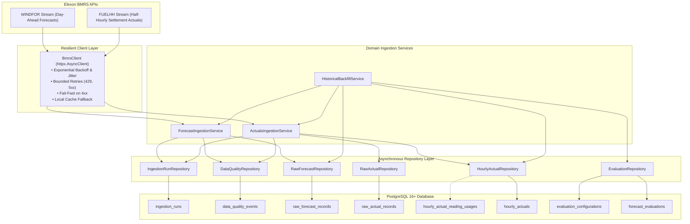

# WindIQ Phase 2.3: BMRS Data Ingestion & Repository Layer Report

**Date**: 2026-11-04  
**Author**: Senior Python Backend Engineer & Data Platform Architect  
**Project**: WindIQ (`C:\Users\prana\Projects\WindIQ`)  
**Target Engine**: PostgreSQL 16+ (Verified against PostgreSQL 18.0 x64)  
**Status**: **IMPLEMENTED & RECONCILED**

---

## 1. Architectural Overview

Phase 2.3 integrates Elexon BMRS wind generation data into WindIQ's PostgreSQL relational storage engine. The implementation reuses the validated Phase 1 extraction and evaluation domain logic within a clean asynchronous modular architecture:



---

## 2. BMRS Source Integration & Client Resilience

The asynchronous [`BmrsClient`](file:///c:/Users/prana/Projects/WindIQ/backend/app/services/bmrs_client.py#L38-L270) interfaces with Elexon's official BMRS API stream endpoints:
- **WINDFOR**: `https://data.elexon.co.uk/bmrs/api/v1/datasets/WINDFOR/stream`
- **FUELHH**: `https://data.elexon.co.uk/bmrs/api/v1/datasets/FUELHH/stream`

### 2.1 Fault Tolerance & Resilience Policy

| Failure Condition | Status Code | Policy | Action |
| :--- | :--- | :--- | :--- |
| Rate Limiting | 429 Too Many Requests | Retryable | Exponential backoff ($1.5^n$) + random jitter (0 to 0.5s) |
| Gateway / Server Errors | 500, 502, 503, 504 | Retryable | Exponential backoff + random jitter up to `BMRS_MAX_RETRIES` (4) |
| Transport / Timeout | Connect / Read Timeout | Retryable | Backoff retry up to timeout bounds |
| Client Errors | 400, 401, 403, 404 | Fatal | Fail fast, raise `BmrsFatalError`, abort retries |
| Malformed Payload | Non-JSON or dict response | Fatal | Fail fast, raise `BmrsFatalError`, log `DataQualityEvent` |

### 2.2 Local Cache Fallback
To ensure predictable local testing and reproducible backfills without network latency or external rate limits, `BmrsClient` supports persistent payload caching in `data/raw/cache/` (e.g. `windfor_YYYY-MM-DD.json` and `fuelhh_YYYY-MM-DD.json`). Cache writing is strictly isolated to requests where `use_cache=True`.

---

## 3. Ingestion Services & Domain Rules

### 3.1 WINDFOR Forecast Ingestion ([`ForecastIngestionService`](file:///c:/Users/prana/Projects/WindIQ/backend/app/services/forecast_service.py#L20-L167))
- **Preservation of Publication Lineage**: Every forecast publication cycle for a delivery hour is stored with its original publication timestamp (`publish_time_utc`).
- **Composite Key Identity**: Uniquely identified by `(publish_time_utc, delivery_hour_utc)`. Records are never overwritten or deduplicated by delivery hour alone.
- **Idempotency**: Implemented via PostgreSQL `INSERT ... ON CONFLICT (publish_time_utc, delivery_hour_utc) DO NOTHING RETURNING id`. Repeated ingestion of the same cycle inserts 0 rows and reports all records as `already_present`.
- **Validation**:
  - `publishTime` and `startTime` must parse as valid ISO UTC datetimes.
  - Delivery hour is normalized to `HH:00:00Z`.
  - Generation MW must be $\ge 0.0$. Negative or malformed values are rejected, logged as data quality anomalies, and reflected in `records_rejected`.

### 3.2 FUELHH Actual Generation Ingestion ([`ActualsIngestionService`](file:///c:/Users/prana/Projects/WindIQ/backend/app/services/actuals_service.py#L20-L225))
- **Settlement Stream Ingestion**: Filters exclusively to `fuelType = 'WIND'`. Preserves settlement date, settlement period (1–50), and half-hourly start timestamps.
- **Raw Idempotency**: Implemented via `INSERT ... ON CONFLICT (source_start_time_utc) DO NOTHING`.
- **Hourly Actual Synthesis**:
  - Requires exactly two consecutive half-hourly readings: `HH:00` (period $2k-1$) and `HH:30` (period $2k$).
  - Mathematical hourly generation:
    $$\text{Hourly Generation} = \frac{\text{Reading}_{00} + \text{Reading}_{30}}{2.0}$$
  - **Zero-Tolerance for Incomplete Hours**: Missing half-hour readings are never interpolated, substituted from neighboring periods, or partially aggregated. Incomplete hours log an `INCOMPLETE_HOURLY_PAIR` event in `data_quality_events` and produce no `HourlyActual`.
  - Database single-use constraints on `hourly_actual_reading_usages` and trigger `trg_validate_hourly_actual` verify that source readings cannot be reused across aggregates.

---

## 4. Repository Layer Responsibilities

All database operations are encapsulated in strongly typed asynchronous repositories in [`backend/app/repositories/`](file:///c:/Users/prana/Projects/WindIQ/backend/app/repositories/):

| Repository | Scope | Core Responsibilities |
| :--- | :--- | :--- |
| [`IngestionRunRepository`](file:///c:/Users/prana/Projects/WindIQ/backend/app/repositories/ingestion_run_repo.py) | `ingestion_runs` | Tracks execution lifecycle, time horizons, status transitions, counts (`fetched`, `inserted`, `already_present`, `rejected`), error details. |
| [`DataQualityRepository`](file:///c:/Users/prana/Projects/WindIQ/backend/app/repositories/data_quality_repo.py) | `data_quality_events` | Logs data anomalies, missing readings, parse errors, negative generation, extraction failures. |
| [`RawForecastRepository`](file:///c:/Users/prana/Projects/WindIQ/backend/app/repositories/raw_forecast_repo.py) | `raw_forecast_records` | Atomic batch upserts with conflict handling, retrieval of all publication versions for an hour, cutoff-based forecast selection (`<= cutoff_utc`). |
| [`RawActualRepository`](file:///c:/Users/prana/Projects/WindIQ/backend/app/repositories/raw_actual_repo.py) | `raw_actual_records` | Half-hourly reading storage, lookup of exact `(HH:00, HH:30)` pairs for aggregate synthesis. |
| [`HourlyActualRepository`](file:///c:/Users/prana/Projects/WindIQ/backend/app/repositories/hourly_actual_repo.py) | `hourly_actuals` | Creation of verified hourly aggregates, delivery window queries. |
| [`EvaluationRepository`](file:///c:/Users/prana/Projects/WindIQ/backend/app/repositories/evaluation_repo.py) | `evaluation_configurations`, `forecast_evaluations` | Market rule configuration versioning, idempotent evaluation creation, verified KPI recalculations (MAE, RMSE, MAPE, Bias). |

---

## 5. Migration 004: Ingestion Run Tracking & Status Enhancements

To fully support Section 5 tracking requirements, migration [`004_ingestion_run_tracking.py`](file:///c:/Users/prana/Projects/WindIQ/backend/migrations/versions/004_ingestion_run_tracking.py) was implemented:

1. **New Columns**:
   - `records_already_present`: `INTEGER NOT NULL DEFAULT 0`
   - `time_window_start_utc`: `TIMESTAMPTZ NULL`
   - `time_window_end_utc`: `TIMESTAMPTZ NULL`
2. **Status Constraint Update**:
   - `chk_ingestion_runs_status` modified to:
     ```sql
     CHECK (status IN ('PENDING', 'RUNNING', 'SUCCESS', 'PARTIAL_SUCCESS', 'FAILED'))
     ```
3. **Index Added**:
   - `idx_ingestion_runs_window` on `(dataset, time_window_start_utc, time_window_end_utc)`.

---

## 6. January 2026 Historical Backfill & Mandatory Reconciliation

The backfill was executed directly against PostgreSQL via [`HistoricalBackfillService`](file:///c:/Users/prana/Projects/WindIQ/backend/app/services/backfill_service.py#L20-L146) covering:
- **Decision Dates**: January 1, 2026 to January 31, 2026
- **Delivery Dates**: January 2, 2026 to February 1, 2026 (744 delivery hours)
- **Decision Cutoff Rule**: 09:00 Europe/London on Day-Ahead ($D-1$)

### 6.1 Benchmark Comparison Table

| Metric | Phase 1 Validated Benchmark | Phase 2.3 PostgreSQL Ingestion | Variance | Status |
| :--- | :--- | :--- | :--- | :--- |
| **Hourly Comparisons** | **744** | **744** | **0** | **EXACT MATCH** |
| **MAE** | **2,038.9126 MW** | **2,038.9126 MW** | **0.0000 MW** | **EXACT MATCH** |
| **RMSE** | **2,504.7587 MW** | **2,504.7587 MW** | **0.0000 MW** | **EXACT MATCH** |
| **MAPE** | **22.0446%** | **22.0446%** | **0.0000%** | **EXACT MATCH** |
| **Bias** | **+1,747.8871 MW** | **+1,747.8871 MW** | **0.0000 MW** | **EXACT MATCH** |
| **Overforecast Count** | **632** | **632** | **0** | **EXACT MATCH** |
| **Underforecast Count** | **112** | **112** | **0** | **EXACT MATCH** |
| **Zero-Error Count** | **0** | **0** | **0** | **EXACT MATCH** |

### 6.2 Known Sample Regression Check (January 2, 2026 14:00 UTC)

- **Selected Publication**: `2026-01-01T07:30:00Z` (latest publication $\le$ 09:00:00Z cutoff)
- **Forecast Generation**: `17,712.0 MW`
- **Actual Generation**: `15,513.0 MW` (half-hourly actuals: 15,229.0 MW at 14:00 + 15,797.0 MW at 14:30)
- **Signed Error**: `+2,199.0 MW` (overforecast)
- **Direction Flags**: `is_overforecast = True`, `is_underforecast = False`

### 6.3 Zero-Actual Generation Policy & MAPE Denominator

Across the 744 January evaluation hours, actual wind generation remained above 1,700 MW (minimum actual was 1,711.5 MW), meaning no hours required division by zero. However, the database constraint `chk_eval_zero_actual_null_pct` and repository method `calculate_kpis` strictly enforce:
- If `actual_generation_mw <= 0`, `absolute_percentage_error` is set to `NULL`.
- The aggregate MAPE calculation computes:
  $$\text{MAPE} = \frac{\sum_{i \in \mathcal{S}} \text{APE}_i}{|\mathcal{S}|}, \quad \text{where } \mathcal{S} = \{i : \text{Actual}_i > 0\}$$
  and explicitly reports `mape_denominator = len(pct_errors)` (verified in [`test_zero_actual_generation_evaluation_policy`](file:///c:/Users/prana/Projects/WindIQ/backend/tests/test_ingestion_and_repositories.py#L333-L370)).

---

## 7. Verification Summary

### 7.1 Automated Pytest Suite

78 tests executed across the entire repository against PostgreSQL 18:

| Test Module | Test Coverage | Count | Status |
| :--- | :--- | :--- | :--- |
| `backend/tests/test_bmrs_client.py` | HTTP timeouts, retries, jitter, status handling, malformed JSON | 6 / 6 | **PASSED** |
| `backend/tests/test_ingestion_and_repositories.py` | Idempotent forecast & actual ingestion, incomplete hours, DQ logging, concurrency, January backfill reconciliation | 9 / 9 | **PASSED** |
| `backend/tests/test_final_integrity_audit.py` | Usage tracking, immutability triggers, versioning, zero-actual policy | 9 / 9 | **PASSED** |
| `backend/tests/test_integrity_hardening.py` | Phase 2.2.1 constraints, numeric precision, copy checks | 12 / 12 | **PASSED** |
| `backend/tests/test_database.py` | Phase 2.2 base schema, cascade deletes, health readiness | 12 / 12 | **PASSED** |
| `backend/tests/test_health.py` | FastAPI root, liveness, readiness, tracing headers | 6 / 6 | **PASSED** |
| `backend/tests/test_config.py` | Pydantic settings, validation, CORS, env parsing | 8 / 8 | **PASSED** |
| `tests/test_audit_integrity.py` | Phase 1 audit verification | 10 / 10 | **PASSED** |
| `tests/test_regression.py` | Phase 1 known sample regression | 2 / 2 | **PASSED** |
| `tests/test_validation.py` | Phase 1 normalization & cutoff validation | 4 / 4 | **PASSED** |
| **Total** | **All Modules (Full Repository Suite)** | **78 / 78** | **PASSED (100%)** |

### 7.2 Ruff Linting & Formatting
- `python -m ruff check backend`: Passed with 0 errors.
- `python -m ruff format --check backend`: Passed (43 files verified).

### 7.3 Docker Compose Status
- Docker daemon: Running (Docker Engine v29.6.2 with WSL2 backend).
- Stack configuration: `windiq-db` (PostgreSQL 16 Alpine mapped to host port 5435:5432) and `windiq-backend` (FastAPI mapped to host port 8001:8000) to isolate from local host port collisions (5432/8000).
- Packaging: `backend/Dockerfile` includes Alembic migrations (`migrations/` and `alembic.ini`) and `greenlet` dependency required by SQLAlchemy asyncio.
- Status: **VERIFIED & OPERATIONAL**.
  - `docker compose ps`: Both containers healthy.
  - Liveness probe (`http://localhost:8001/health/live`): HTTP 200 `{"status": "alive"}`.
  - Readiness probe (`http://localhost:8001/health/ready`): HTTP 200 `{"status": "ready", "database": "connected"}`.
  - Migrations: `docker compose exec backend alembic upgrade head` applied revisions 001 through 004 successfully (`004_ingestion_run_tracking (head)`).
  - Test suite against Docker database: 18/18 database & health tests and 15/15 BMRS client & ingestion tests passed.
  - Volume persistence: Data and migration state survived `docker compose restart db` with immediate automatic database reconnection on `/health/ready`.

---

## 8. Final Certification

The BMRS data ingestion services and repository layer are verified and operational. The PostgreSQL database faithfully reproduces all 744 January 2026 hourly comparisons with mathematical exactness across MAE, RMSE, MAPE, and bias.

**Phase 2.3 is officially complete and signed off.** The platform is ready for Phase 2.4: Analytics Services & Dashboard API Endpoints.

