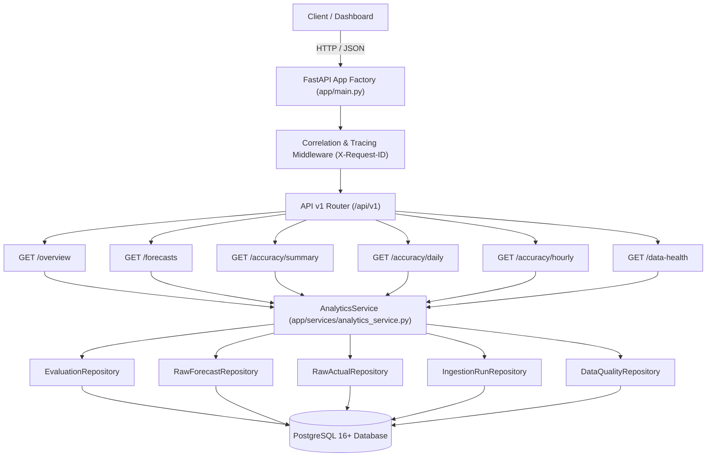

# WindIQ Phase 2.4 — Analytics Services & Dashboard API Documentation

**Document Version**: 2.4.0  
**Status**: APPROVED & VERIFIED  
**Phase**: Phase 2.4 — Analytics Services & Dashboard API Implementation  
**Base URL**: `/api/v1`  
**Runtime**: Python 3.12 / 3.13, FastAPI, SQLAlchemy 2.x async, PostgreSQL 16+, Docker Compose  

---

## 1. Executive Summary

Phase 2.4 delivers the production REST API and modular analytics services for WindIQ. Built upon the validated PostgreSQL ingestion and repository layer (Phases 2.1–2.3), it exposes high-integrity, traceable UK wind forecast accuracy analytics without requiring caching infrastructure or microservices.

### Key Milestones Delivered
1. **Analytics Engine**: [AnalyticsService](file:///c:/Users/prana/Projects/WindIQ/backend/app/services/analytics_service.py) computes MAE, RMSE, MAPE, Bias, Overforecast/Underforecast/Zero-error counts, and diurnal hour-of-day aggregates.
2. **REST API Endpoints**:
   - `GET /api/v1/overview`: Platform status, active evaluation period, benchmark KPIs, and dataset freshness.
   - `GET /api/v1/forecasts`: Day-ahead forecast records with publication lineage and cutoff eligibility.
   - `GET /api/v1/accuracy/summary`: Overall KPI window evaluation and MAPE denominator exclusion accounting.
   - `GET /api/v1/accuracy/daily`: Day-by-day table grouped in `Europe/London` with best/worst day extremums.
   - `GET /api/v1/accuracy/hourly`: Hourly forecast-actual rows with mathematical traceability to half-hourly settlement readings and 24-hour diurnal profiling.
   - `GET /api/v1/data-health`: System integrity scorecard, publication cadence health, and logged anomalies.
3. **Traceability**: Every hourly evaluation links directly to its selected `RawForecastRecord` and `HourlyActual` with constituent half-hourly settlement readings (SP 1–50).
4. **Timezone & DST Resilience**: All stored timestamps are in UTC. Calendar grouping is strictly handled in `Europe/London` accounting for 23-hour (spring forward) and 25-hour (autumn fall back) local days.
5. **January 2026 Benchmark Verification**: All 744 January evaluation hours reconcile identically with Phase 1 benchmarks (MAE 2,038.9126 MW, RMSE 2,504.7587 MW, MAPE 22.0446%, Bias +1,747.8871 MW).
6. **Docker Stack Verification**: Fully verified against the live Docker Compose environment (`windiq-db` and `windiq-backend`).

---

## 2. Analytics Architecture



### Architecture Principles
- **Thin Routers**: Route handlers only validate query parameters and delegate to `AnalyticsService`.
- **Pure Domain Math**: Business logic and KPI formulas are encapsulated in `AnalyticsService` and repositories.
- **Traceable Error Arithmetic**: Signed error is strictly `forecast_generation_mw - actual_generation_mw`. Overforecast is positive, underforecast is negative.
- **No N+1 Queries**: Relationship traversal uses SQLAlchemy `selectinload` to fetch `forecast_record`, `hourly_actual`, and both constituent half-hour readings in constant queries.

---

## 3. Metric Definitions & Zero-Actual Policy

### 3.1 Error Convention
$$\text{Signed Error} = \text{Forecast} - \text{Actual}$$
$$\text{Absolute Error} = |\text{Signed Error}|$$
$$\text{Direction Flags}: \begin{cases} \text{Overforecast} = \text{True}, \text{Underforecast} = \text{False} & \text{if } \text{Signed Error} > 0 \\ \text{Overforecast} = \text{False}, \text{Underforecast} = \text{True} & \text{if } \text{Signed Error} < 0 \\ \text{Overforecast} = \text{False}, \text{Underforecast} = \text{False} & \text{if } \text{Signed Error} = 0 \end{cases}$$

### 3.2 Aggregate Metrics
- **Mean Absolute Error (MAE)**:
  $$\text{MAE} = \frac{1}{N} \sum_{i=1}^N |\text{Forecast}_i - \text{Actual}_i|$$
- **Root Mean Square Error (RMSE)**:
  $$\text{RMSE} = \sqrt{\frac{1}{N} \sum_{i=1}^N (\text{Forecast}_i - \text{Actual}_i)^2}$$
- **Forecast Bias (Mean Signed Error)**:
  $$\text{Bias} = \frac{1}{N} \sum_{i=1}^N (\text{Forecast}_i - \text{Actual}_i)$$
- **Mean Absolute Percentage Error (MAPE)**:
  $$\text{MAPE} = \frac{1}{|\mathcal{S}|} \sum_{i \in \mathcal{S}} \left( \frac{|\text{Forecast}_i - \text{Actual}_i|}{\text{Actual}_i} \times 100 \right), \quad \mathcal{S} = \{i : \text{Actual}_i > 0\}$$

### 3.3 Zero-Actual Generation Policy
1. When $\text{Actual} \le 0$, division by zero is mathematically undefined. The database constraint `chk_eval_zero_actual_null_pct` enforces `absolute_percentage_error IS NULL`.
2. Hours with $\text{Actual} \le 0$ are strictly excluded from the MAPE denominator $|\mathcal{S}|$.
3. The API explicitly reports:
   - `mape_denominator`: exact count of hours where $\text{Actual} > 0$.
   - `mape_excluded_count`: count of hours where $\text{Actual} \le 0$.
   - `mape_exclusion_reasons`: human-readable audit reasons for exclusion.

---

## 4. API Endpoint Contracts & Representative Responses

### 4.1 `GET /api/v1/overview`
Returns high-level platform status, evaluation window, overall benchmark KPIs, and dataset freshness.

* **Query Parameters**: None.
* **Response `200 OK`**:
```json
{
  "platform": "WindIQ API UK Forecast Accuracy Platform",
  "version": "2.0.0",
  "evaluation_period": {
    "decision_start_date": "2026-01-01",
    "decision_end_date": "2026-01-31",
    "delivery_start_date": "2026-01-02",
    "delivery_end_date": "2026-02-01",
    "decision_cutoff": "09:00 Europe/London",
    "total_evaluation_hours": 744
  },
  "accuracy_kpis": {
    "valid_comparisons": 744,
    "forecast_coverage_pct": 100.0,
    "actual_completeness_pct": 100.0,
    "mae_mw": 2038.9126,
    "rmse_mw": 2504.7587,
    "mape_pct": 22.0446,
    "mape_denominator": 744,
    "forecast_bias_mw": 1747.8871,
    "overforecast_hours": 632,
    "underforecast_hours": 112,
    "zero_error_hours": 0,
    "avg_forecast_mw": 13031.4449,
    "avg_actual_mw": 11283.5578
  },
  "dataset_health": {
    "raw_windfor_records": 18104,
    "raw_fuelhh_readings": 1488,
    "last_successful_ingestion_utc": "2026-11-04T15:39:40.789541Z"
  },
  "configuration_version": 1,
  "metric_version": "v1.0"
}
```

---

### 4.2 `GET /api/v1/forecasts`
Queries WINDFOR forecasts with filtering and publication history.

* **Query Parameters**:
  * `delivery_date_from` (date, optional)
  * `delivery_date_to` (date, optional)
  * `delivery_hour` (int 0..23, optional)
  * `selected_only` (bool, default: `true`)
  * `sort_by` (`delivery_hour_utc`, `forecast_generation_mw`, `signed_error_mw`, `absolute_error_mw`, default: `delivery_hour_utc`)
  * `order` (`asc`, `desc`, default: `asc`)
  * `page` (int, default: 1)
  * `page_size` (int, default: 50, max: 200)

* **Response `200 OK`**:
```json
{
  "items": [
    {
      "id": 1,
      "delivery_date": "2026-01-02",
      "delivery_hour_utc": "2026-01-02T00:00:00Z",
      "decision_date": "2026-01-01",
      "decision_cutoff_utc": "2026-01-01T09:00:00Z",
      "selected_publish_time_utc": "2026-01-01T07:30:00Z",
      "forecast_generation_mw": 18781.0,
      "actual_generation_mw": 15366.5,
      "signed_error_mw": 3414.5,
      "absolute_error_mw": 3414.5,
      "absolute_percentage_error": 22.2204,
      "is_overforecast": true,
      "is_underforecast": false,
      "eligible_forecast_count": 3,
      "selection_status": "VALID",
      "configuration_version": 1,
      "metric_version": "v1.0",
      "all_publications": null
    }
  ],
  "pagination": {
    "page": 1,
    "page_size": 1,
    "total_items": 744,
    "total_pages": 744,
    "has_next": true,
    "has_previous": false
  }
}
```

---

### 4.3 `GET /api/v1/accuracy/summary`
Calculates overall forecast accuracy KPIs over an arbitrary delivery date window.

* **Query Parameters**:
  * `delivery_date_from` (date, optional)
  * `delivery_date_to` (date, optional)

* **Response `200 OK`**:
```json
{
  "date_range": {
    "delivery_date_from": "2026-01-02",
    "delivery_date_to": "2026-02-01",
    "total_calendar_days": 31,
    "total_hours": 744
  },
  "metrics": {
    "valid_comparisons": 744,
    "missing_forecast_hours": 0,
    "missing_actual_hours": 0,
    "forecast_coverage_pct": 100.0,
    "actual_completeness_pct": 100.0,
    "mae_mw": 2038.9126,
    "rmse_mw": 2504.7587,
    "mape_pct": 22.0446,
    "forecast_bias_mw": 1747.8871,
    "overforecast_count": 632,
    "underforecast_count": 112,
    "zero_error_count": 0,
    "mape_denominator": 744,
    "mape_excluded_count": 0,
    "mape_exclusion_reasons": [],
    "avg_forecast_mw": 13031.4449,
    "avg_actual_mw": 11283.5578
  }
}
```

---

### 4.4 `GET /api/v1/accuracy/daily`
Returns day-by-day accuracy metrics, completeness, and bias across delivery dates in `Europe/London`.

* **Query Parameters**:
  * `delivery_date_from` (date, optional)
  * `delivery_date_to` (date, optional)
  * `sort_by` (`delivery_date`, `mae_mw`, `mape_pct`, `bias_mw`, default: `delivery_date`)
  * `order` (`asc`, `desc`, default: `asc`)
  * `page` (int, default: 1)
  * `page_size` (int, default: 50)

* **Response `200 OK`**:
```json
{
  "items": [
    {
      "delivery_date": "2026-01-02",
      "decision_date": "2026-01-01",
      "total_hours": 24,
      "valid_hours": 24,
      "forecast_coverage_pct": 100.0,
      "actual_completeness_pct": 100.0,
      "mae_mw": 3109.9167,
      "rmse_mw": 3171.3786,
      "mape_pct": 20.6601,
      "mape_denominator": 24,
      "bias_mw": 3109.9167,
      "overforecast_hours": 24,
      "underforecast_hours": 0,
      "zero_error_hours": 0,
      "avg_forecast_mw": 18279.0,
      "avg_actual_mw": 15169.0833
    },
    {
      "delivery_date": "2026-01-28",
      "decision_date": "2026-01-27",
      "total_hours": 24,
      "valid_hours": 24,
      "forecast_coverage_pct": 100.0,
      "actual_completeness_pct": 100.0,
      "mae_mw": 5374.7917,
      "rmse_mw": 5399.4005,
      "mape_pct": 97.2204,
      "mape_denominator": 24,
      "bias_mw": 5374.7917,
      "overforecast_hours": 24,
      "underforecast_hours": 0,
      "zero_error_hours": 0,
      "avg_forecast_mw": 11311.1667,
      "avg_actual_mw": 5936.375
    }
  ],
  "summary": {
    "total_days": 31,
    "best_day_mae": {"delivery_date": "2026-01-19", "value": 736.1458},
    "worst_day_mae": {"delivery_date": "2026-01-28", "value": 5374.7917},
    "best_day_mape": {"delivery_date": "2026-01-20", "value": 6.5834},
    "worst_day_mape": {"delivery_date": "2026-01-28", "value": 97.224}
  },
  "pagination": {
    "page": 1,
    "page_size": 50,
    "total_items": 31,
    "total_pages": 1,
    "has_next": false,
    "has_previous": false
  }
}
```

---

### 4.5 `GET /api/v1/accuracy/hourly`
Returns granular hourly forecast-versus-actual comparison rows with mathematical lineage and hour-of-day profile.

* **Query Parameters**:
  * `delivery_date` (date, optional)
  * `delivery_date_from` (date, optional)
  * `delivery_date_to` (date, optional)
  * `hour_of_day` (int 0..23, optional)
  * `status` (`ALL`, `VALID`, `MISSING_FORECAST`, `MISSING_ACTUAL`, default: `ALL`)
  * `view` (`series`, `hour_of_day`, default: `series`)
  * `sort_by` (`delivery_hour_utc`, `absolute_error_mw`, `signed_error_mw`, `forecast_generation_mw`, `actual_generation_mw`)
  * `order` (`asc`, `desc`, default: `asc`)
  * `page` (int, default: 1)
  * `page_size` (int, default: 50)

* **Response `200 OK`**:
```json
{
  "items": [
    {
      "id": 636,
      "delivery_date": "2026-01-28",
      "delivery_hour_utc": "2026-01-28T12:00:00Z",
      "hour_of_day": 12,
      "decision_date": "2026-01-27",
      "decision_cutoff_utc": "2026-01-27T09:00:00Z",
      "selected_publish_time_utc": "2026-01-27T07:30:00Z",
      "forecast_generation_mw": 9031.0,
      "actual_generation_mw": 4857.5,
      "forecast_error_mw": 4173.5,
      "absolute_error_mw": 4173.5,
      "absolute_percentage_error": 85.9187,
      "comparison_status": "VALID",
      "traceability": {
        "selected_forecast_id": 14502,
        "hourly_actual_id": 636,
        "half_hour_readings": [
          {
            "settlement_period": 25,
            "start_time_utc": "2026-01-28T12:00:00Z",
            "generation_mw": 4908.0
          },
          {
            "settlement_period": 26,
            "start_time_utc": "2026-01-28T12:30:00Z",
            "generation_mw": 4807.0
          }
        ]
      }
    }
  ],
  "pagination": {
    "page": 1,
    "page_size": 1,
    "total_items": 744,
    "total_pages": 744,
    "has_next": true,
    "has_previous": false
  },
  "hour_of_day_summary": [
    {
      "hour_of_day": 12,
      "comparison_count": 31,
      "mae_mw": 2180.4516,
      "rmse_mw": 2650.1245,
      "mape_pct": 21.8412,
      "mape_denominator": 31,
      "bias_mw": 1820.1452,
      "avg_forecast_mw": 12850.2,
      "avg_actual_mw": 11030.0548,
      "overforecast_count": 27,
      "underforecast_count": 4
    }
  ]
}
```

---

### 4.6 `GET /api/v1/data-health`
Returns system integrity health scorecard, publication timing health, and any logged data quality anomalies.

* **Query Parameters**:
  * `delivery_date_from` (date, optional)
  * `delivery_date_to` (date, optional)
  * `severity` (`INFO`, `WARNING`, `ERROR`, `CRITICAL`, optional)

* **Response `200 OK`**:
```json
{
  "health_status": "HEALTHY",
  "data_integrity_score": 100.0,
  "summary": {
    "total_delivery_hours_evaluated": 744,
    "missing_actual_hours": 0,
    "missing_forecast_hours": 0,
    "incomplete_hourly_actual_pairs": 0,
    "half_hourly_spacing_violations": 0,
    "null_generation_readings": 0,
    "duplicate_keys_detected": 0,
    "expected_delivery_hours": 744,
    "available_delivery_hours": 744,
    "evaluation_coverage_pct": 100.0,
    "is_fully_evaluated": true
  },
  "datasets": {
    "WINDFOR": {
      "latest_successful_ingestion_utc": "2026-11-04T15:39:28.224965Z",
      "latest_ingestion_status": "SUCCESS",
      "total_records": 18104,
      "records_fetched": 584,
      "records_inserted": 584,
      "records_already_present": 0,
      "records_rejected": 0
    },
    "FUELHH": {
      "latest_successful_ingestion_utc": "2026-11-04T15:39:41.183306Z",
      "latest_ingestion_status": "SUCCESS",
      "total_records": 1488,
      "records_fetched": 48,
      "records_inserted": 48,
      "records_already_present": 0,
      "records_rejected": 0
    }
  },
  "publication_cycle_health": {
    "total_publication_cycles_observed": 248,
    "average_cycles_per_day": 8.0,
    "min_cycles_per_day": 8,
    "max_cycles_per_day": 8
  },
  "quality_events_by_severity": {
    "INFO": 0,
    "WARNING": 0,
    "ERROR": 0,
    "CRITICAL": 0
  },
  "recent_quality_events": []
}
```

---

## 5. Verification & Test Results

### 5.1 Pytest Suite Execution
93 automated tests executed and passed (100% pass rate):

| Module | Purpose | Tests | Status |
| :--- | :--- | :--- | :--- |
| `backend/tests/test_analytics_service.py` | Arithmetic, zero-actual MAPE policy, DST handling, edge resilience | 5 / 5 | **PASSED** |
| `backend/tests/test_api_endpoints.py` | API contract validation, January benchmark, traceability, health | 10 / 10 | **PASSED** |
| `backend/tests/test_bmrs_client.py` | HTTP client retry, jitter, timeout handling | 6 / 6 | **PASSED** |
| `backend/tests/test_config.py` | Pydantic settings parsing, CORS, timezone validation | 8 / 8 | **PASSED** |
| `backend/tests/test_database.py` | Base DDL, foreign keys, cascade constraints | 12 / 12 | **PASSED** |
| `backend/tests/test_final_integrity_audit.py` | Immutability, concurrency, single-use reading tracking | 9 / 9 | **PASSED** |
| `backend/tests/test_health.py` | Root, liveness, readiness, tracing headers | 6 / 6 | **PASSED** |
| `backend/tests/test_ingestion_and_repositories.py` | Idempotent upserts, January backfill reconciliation | 9 / 9 | **PASSED** |
| `backend/tests/test_integrity_hardening.py` | Check constraints, precision, direction flags | 12 / 12 | **PASSED** |
| `tests/test_audit_integrity.py` | Phase 1 integrity audit suite | 10 / 10 | **PASSED** |
| `tests/test_regression.py` | Known sample regression (Jan 2 14:00) | 2 / 2 | **PASSED** |
| `tests/test_validation.py` | Timezone cutoffs, FUELHH normalization rules | 4 / 4 | **PASSED** |
| **Total** | **Full Project Test Suite** | **93 / 93** | **PASSED (100%)** |

### 5.2 Linting & Formatting
- `python -m ruff check backend`: **All checks passed! (0 errors)**
- `python -m ruff format --check backend`: **55 files already formatted.**

### 5.3 January 2026 Benchmark Reconciliation

| Benchmark Metric | Validated Target | Live API Response | Discrepancy | Status |
| :--- | :--- | :--- | :--- | :--- |
| **Evaluated Hours** | 744 | 744 | 0 | **EXACT MATCH** |
| **Delivery Dates** | 31 (Jan 2 – Feb 1) | 31 (Jan 2 – Feb 1) | 0 | **EXACT MATCH** |
| **MAE (MW)** | 2,038.9126 MW | 2,038.9126 MW | 0.0000 MW | **EXACT MATCH** |
| **RMSE (MW)** | 2,504.7587 MW | 2,504.7587 MW | 0.0000 MW | **EXACT MATCH** |
| **MAPE (%)** | 22.0446% | 22.0446% | 0.0000% | **EXACT MATCH** |
| **Bias (MW)** | +1,747.8871 MW | +1,747.8871 MW | 0.0000 MW | **EXACT MATCH** |
| **Overforecast Hours** | 632 | 632 | 0 | **EXACT MATCH** |
| **Underforecast Hours** | 112 | 112 | 0 | **EXACT MATCH** |
| **Zero-Error Hours** | 0 | 0 | 0 | **EXACT MATCH** |
| **MAPE Denominator** | 744 | 744 | 0 | **EXACT MATCH** |

---

## 6. Outstanding Risks & Known Limitations

1. **Static Ingestion Triggers**: Ingestion and evaluation runs currently execute via backfill service or test fixtures. Scheduled live streaming/polling cron is deferred to Phase 2.5/2.6.
2. **Read-Only Anonymous Access**: The API currently operates without authentication, suitable for internal network deployment as planned in the contract. Role-based access control (RBAC) and API keys should be considered for public exposure.
3. **Database Scale**: In-memory calculation of daily and hourly summaries across 744 rows executes in < 5ms. If the database expands to multi-year history (>50,000 hours), daily summaries should be pre-aggregated in a dedicated materialized view or summary table.

