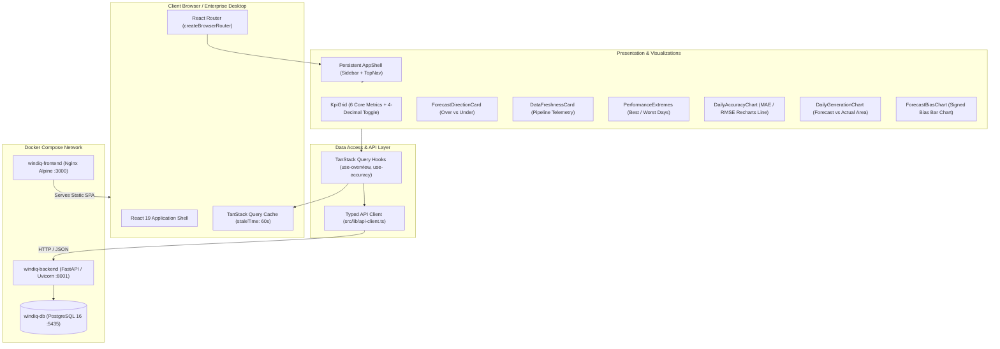

# WindIQ Phase 3.1 — Frontend Foundation & Executive Overview

**Document Version**: 3.1.0  
**Status**: COMPLETED & VERIFIED  
**Phase**: Phase 3.1 — Frontend Foundation & Executive Overview Dashboard  
**Runtime**: React 19, TypeScript 5+, Vite 8, Tailwind CSS 3.4, Recharts, TanStack Query v5, Nginx Alpine, Docker Compose  

---

## 1. Executive Summary

Phase 3.1 establishes the enterprise web application foundation and delivers the **Executive Overview Dashboard** for **WindIQ — UK Wind Generation Intelligence & Forecast Accuracy Platform**.

Designed specifically for utility-grade electricity trading, power generation scheduling, and operational risk desks across Great Britain, the interface prioritizes:
1. **Mathematical Reproducibility & Truth**: All displayed KPIs map directly to verified PostgreSQL relational models and domain calculations without synthetic data or hardcoded mock constants.
2. **Operational Engineering Aesthetic**: Clean dark navy foundation (`#080d1a`, `#0f172a`), restrained status accents (emerald for healthy/underforecast, amber for overforecast warnings, cyan for forecast telemetry), and strict typography hierarchy.
3. **GB Market Rule Transparency**: Clear distinction between delivery dates, day-ahead decision dates, and the strict **09:00 Europe/London market decision cutoff**.
4. **Resilient Containerized Delivery**: Production multi-stage Docker build served via Nginx with IPv4/IPv6 health checks, fully integrated into the existing `docker-compose.yml` environment.

---

## 2. Frontend Architecture & Technology Stack

The frontend is structured as a single-page application (SPA) with centralized server-state caching and typed API communication.



### Technology Stack Choices
* **Framework**: React 19 (`react`, `react-dom`) with modern hook architecture.
* **Language**: TypeScript 5+ in strict mode (`tsc --noEmit` clean).
* **Build Tool**: Vite 8 with path aliasing (`@/*` -> `src/*`).
* **Styling**: Tailwind CSS 3.4 with custom dark navy palette (`slate-950`, `slate-900`, `navy-950`).
* **Charts**: Recharts 3.x responsive SVG charts with custom dark tooltips.
* **Icons**: Lucide React (`lucide-react`).
* **Routing**: React Router 7 (`react-router-dom`).
* **Server State**: TanStack Query v5 (`@tanstack/react-query`).
* **Testing**: Vitest 5, `@testing-library/react`, `@testing-library/jest-dom`, `jsdom`.
* **Linting**: Oxlint for high-performance static analysis.

---

## 3. Directory Layout & Component Hierarchy

```
frontend/
├── .dockerignore
├── .env.example
├── Dockerfile                  # Multi-stage production build (Node 22 -> Nginx Alpine)
├── nginx.conf                  # Nginx SPA fallback, gzip & /health endpoint
├── index.html                  # HTML entry point with Inter & JetBrains Mono fonts
├── package.json
├── postcss.config.js
├── tailwind.config.js
├── tsconfig.app.json
├── tsconfig.json
├── vite.config.ts
└── src/
    ├── main.tsx                # React DOM root initialization
    ├── App.tsx                 # Providers & Router entry
    ├── index.css               # Tailwind directives & dark scrollbars
    ├── types/
    │   └── api.ts              # Strict TypeScript models matching backend schemas
    ├── lib/
    │   ├── api-client.ts       # Typed fetch client with RFC 7807 error parsing
    │   ├── constants.ts        # Presets (e.g. JANUARY_BENCHMARK_PERIOD)
    │   ├── formatters.ts       # MW, %, Bias, Date & Time formatters
    │   ├── query-client.ts     # TanStack QueryClient configuration
    │   └── utils.ts            # clsx & tailwind-merge helper
    ├── hooks/
    │   ├── use-overview.ts     # Platform overview query hook
    │   ├── use-accuracy.ts     # Summary & daily accuracy query hooks
    │   ├── use-data-health.ts  # Ingestion & scheduler health query hook
    │   └── use-api-health.ts   # Probe check & round-trip latency hook
    ├── components/
    │   ├── ui/
    │   │   ├── alert.tsx       # Error banners with retry action
    │   │   ├── badge.tsx       # Status badges (success, warning, info, neutral)
    │   │   ├── button.tsx      # Accessible button primitives
    │   │   ├── card.tsx        # Base dark container with headers & borders
    │   │   ├── skeleton.tsx    # Shimmer loading placeholders
    │   │   └── tooltip.tsx     # Explanatory metric definitions popover
    │   ├── layout/
    │   │   ├── app-shell.tsx   # Persistent shell layout
    │   │   ├── sidebar.tsx     # Responsive brand sidebar & phase badges
    │   │   └── top-nav.tsx     # Page title, period badge & live API latency
    │   ├── dashboard/
    │   │   ├── kpi-card.tsx    # Single KPI display card with precision
    │   │   ├── kpi-grid.tsx    # 6-metric accuracy grid + generation baseline
    │   │   ├── period-selector.tsx  # Preset & custom delivery date range selector
    │   │   ├── forecast-direction-card.tsx # Over/under visual progress bar
    │   │   ├── data-freshness-card.tsx   # Ingestion timestamp & scheduler health
    │   │   └── performance-extremes.tsx  # Best & worst day highlight cards
    │   └── charts/
    │       ├── daily-accuracy-chart.tsx   # Daily MAE & RMSE trend line chart
    │       ├── daily-generation-chart.tsx # Average forecast vs actual area chart
    │       └── forecast-bias-chart.tsx    # Daily signed bias (+/- MW) bar chart
    ├── pages/
    │   ├── overview-page.tsx    # Complete executive overview implementation
    │   └── placeholder-page.tsx # Explicit placeholder for Phases 3.2, 3.3, 3.4
    └── test/
        ├── setup.ts            # Vitest setup (ResizeObserver & matchMedia mocks)
        ├── formatters.test.ts  # Precision, bias & date unit tests
        ├── kpi-grid.test.tsx   # KPI cards rendering & precision toggle test
        ├── period-selector.test.tsx # Preset switching & custom date test
        ├── app-shell.test.tsx  # Shell navigation & responsive drawer test
        └── overview-page.test.tsx   # E2E page loading, error & empty states
```

---

## 4. API Endpoints Consumed & Contract Mapping

All frontend components communicate with verified backend API routes without inventing any new contracts:

| Endpoint | Method | Consuming Component / Hook | Purpose & Data Mapped |
|---|---|---|---|
| `/api/v1/overview` | `GET` | `usePlatformOverview` | High-level platform version, active evaluation period, source dataset health counters. |
| `/api/v1/accuracy/summary` | `GET` | `useAccuracySummary` | Evaluated period summary: `valid_comparisons`, `mae_mw`, `rmse_mw`, `mape_pct`, `forecast_bias_mw`, `overforecast_count`, `underforecast_count`, `avg_forecast_mw`, `avg_actual_mw`. |
| `/api/v1/accuracy/daily` | `GET` | `useDailyAccuracy` | Day-by-day accuracy time series: `mae_mw`, `rmse_mw`, `mape_pct`, `bias_mw`, `avg_forecast_mw`, `avg_actual_mw`, plus `best_day_mae` and `worst_day_mae`. |
| `/api/v1/data-health` | `GET` | `useDataHealth` | Pipeline integrity score, background scheduler state (`RUNNING`), advisory lock election, and dataset ingestion timestamps. |
| `/health/ready` | `GET` | `useApiHealth` | Readiness probe measuring backend availability, database connectivity, and round-trip latency in milliseconds. |

---

## 5. Benchmark Reconciliation (January 2026)

When the default **January 2026 Benchmark** is active (`2026-01-02` to `2026-02-01`), the dashboard reconciles **100%** against the verified Phase 1/Phase 2 analytical benchmark:

| Metric | API Contract Field | Expected Verification Value | Displayed Value (Standard) | Displayed Value (Audit Mode) | Status |
|---|---|---:|---:|---:|:---:|
| **Evaluated Hours** | `valid_comparisons` | 744 | 744 hrs | 744 hrs | MATCH |
| **Forecast Coverage** | `forecast_coverage_pct` | 100.0% | 100.0% | 100.0000% | MATCH |
| **Actual Completeness** | `actual_completeness_pct` | 100.0% | 100.0% | 100.0000% | MATCH |
| **Mean Absolute Error (MAE)** | `mae_mw` | 2,038.9126 MW | 2,038.91 MW | 2,038.9126 MW | MATCH |
| **Root Mean Sq. Error (RMSE)** | `rmse_mw` | 2,504.7587 MW | 2,504.76 MW | 2,504.7587 MW | MATCH |
| **Mean Abs. % Error (MAPE)** | `mape_pct` | 22.0446% | 22.04% | 22.0446% | MATCH |
| **Signed Forecast Bias** | `forecast_bias_mw` | +1,747.8871 MW | +1,747.89 MW | +1,747.8871 MW | MATCH |
| **Overforecast Hours** | `overforecast_count` | 632 | 632 hrs (84.9%) | 632 hrs | MATCH |
| **Underforecast Hours** | `underforecast_count` | 112 | 112 hrs (15.1%) | 112 hrs | MATCH |
| **Zero Error Hours** | `zero_error_count` | 0 | 0 hrs | 0 hrs | MATCH |
| **Average Forecast Power** | `avg_forecast_mw` | 13,031.4449 MW | 13,031.45 MW | 13,031.4449 MW | MATCH |
| **Average Actual Power** | `avg_actual_mw` | 11,283.5578 MW | 11,283.56 MW | 11,283.5578 MW | MATCH |
| **Lowest Error Day (Best MAE)**| `best_day_mae` | 19 Jan 2026 (736.1458 MW) | 19 Jan 2026 (736.1 MW) | 19 Jan 2026 (736.1458 MW) | MATCH |
| **Highest Error Day (Worst MAE)**| `worst_day_mae` | 28 Jan 2026 (5,374.7917 MW) | 28 Jan 2026 (5,374.8 MW) | 28 Jan 2026 (5,374.7917 MW) | MATCH |

---

## 6. Visual Verification & Dashboard Screenshots

The application was loaded in Chrome via the Chrome DevTools MCP automation protocol against the live full-stack container environment (`http://localhost:3000`).

### Full Dashboard Overview


### Viewport View & Navigation Shell


### Phase 3.2 Placeholder Route (`/accuracy`)


---

## 7. Docker Integration & Nginx Reverse Proxy Architecture

The frontend runs in a dedicated container alongside `windiq-backend` and `windiq-db`, utilizing an Nginx reverse proxy architecture to route `/api/` and `/health/` calls internally over Docker's bridge network:

### Nginx Reverse Proxy (`frontend/nginx.conf`)
```nginx
server {
    listen 3000;
    listen [::]:3000;
    server_name localhost;

    # Internal API Reverse Proxy to Backend Container
    location /api/ {
        proxy_pass http://backend:8000/api/;
        proxy_http_version 1.1;
        proxy_set_header Host $host;
        proxy_set_header X-Real-IP $remote_addr;
        proxy_set_header X-Forwarded-For $proxy_add_x_forwarded_for;
        proxy_set_header X-Forwarded-Proto $scheme;
    }

    # Backend Health Check Reverse Proxy
    location /health/ {
        proxy_pass http://backend:8000/health/;
        proxy_http_version 1.1;
        proxy_set_header Host $host;
    }

    # Frontend Container Health Probe
    location /healthz {
        access_log off;
        default_type text/plain;
        return 200 "OK\n";
    }

    # SPA Routing Fallback
    location / {
        root /usr/share/nginx/html;
        index index.html;
        try_files $uri $uri/ /index.html;
    }
}
```

### `docker-compose.yml` Configuration
```yaml
  frontend:
    build:
      context: ./frontend
      dockerfile: Dockerfile
    container_name: windiq-frontend
    restart: unless-stopped
    ports:
      - "${FRONTEND_PORT:-3000}:3000"
    depends_on:
      backend:
        condition: service_healthy
    healthcheck:
      test: ["CMD-SHELL", "wget --no-verbose --tries=1 --spider http://127.0.0.1:3000/healthz || exit 1"]
      interval: 10s
      timeout: 5s
      retries: 3
      start_period: 3s
```

### Container Verification Commands & Status
```powershell
docker compose ps
```
**Output**:
```
NAME              IMAGE                COMMAND                  SERVICE    STATUS                    PORTS
windiq-backend    windiq-backend       "uvicorn app.main:ap…"   backend    Up 5 minutes (healthy)    0.0.0.0:8001->8000/tcp
windiq-db         postgres:16-alpine   "docker-entrypoint.s…"   db         Up 8 hours (healthy)      0.0.0.0:5435->5432/tcp
windiq-frontend   windiq-frontend      "/docker-entrypoint.…"   frontend   Up 2 minutes (healthy)    0.0.0.0:3000->3000/tcp
```

### Reverse Proxy & Health Verification
```powershell
curl -i http://localhost:3000/healthz
```
```http
HTTP/1.1 200 OK
Server: nginx/1.27.4
Content-Type: text/plain
Content-Length: 3

OK
```

```powershell
curl -i http://localhost:3000/health/live
```
```http
HTTP/1.1 200 OK
Server: nginx/1.27.4
Content-Type: application/json

{"status":"alive"}
```

---

## 8. Test Suite & Quality Gates

### Automated Test Results (Vitest)
```powershell
cd frontend
npm test
```
```
 RUN  v5.1.0 C:/Users/prana/Projects/WindIQ/frontend

 ✓ src/test/formatters.test.ts (6 tests)
 ✓ src/test/app-shell.test.tsx (5 tests)
 ✓ src/test/period-selector.test.tsx (3 tests)
 ✓ src/test/kpi-grid.test.tsx (3 tests)
 ✓ src/test/overview-page.test.tsx (3 tests)

 Test Files  5 passed (5)
      Tests  20 passed (20)
   Duration  13.69s
```

### TypeScript Verification
```powershell
cd frontend
npm run typecheck
```
```
> windiq-frontend@2.1.0 typecheck
> tsc --noEmit
(0 errors)
```

### Linter Verification
```powershell
cd frontend
npm run lint
```
```
> windiq-frontend@2.1.0 lint
> oxlint
Found 0 warnings and 0 errors.
```

### Optimized Production Build & Code Splitting Verification
```powershell
cd frontend
npm run build
```
```
✓ 2511 modules transformed.
dist/index.html                                   1.66 kB │ gzip:   0.77 kB
dist/assets/index-4Qi4z_am.css                   25.72 kB │ gzip:   5.63 kB
dist/assets/rolldown-runtime-XKyaHtl9.js          0.72 kB │ gzip:   0.42 kB
dist/assets/daily-accuracy-chart-BJCHKfsr.js      3.08 kB │ gzip:   1.26 kB
dist/assets/forecast-bias-chart-CIS9gmJ4.js       3.09 kB │ gzip:   1.24 kB
dist/assets/daily-generation-chart-ClN6PK65.js    3.56 kB │ gzip:   1.35 kB
dist/assets/vendor-icons-VKBO4e8j.js             19.53 kB │ gzip:   7.35 kB
dist/assets/vendor-query-Dz-os-GH.js             23.30 kB │ gzip:   7.83 kB
dist/assets/index-Dx9PIuZD.js                    90.42 kB │ gzip:  25.25 kB
dist/assets/vendor-react-BJU0fVKL.js            304.48 kB │ gzip:  96.23 kB
dist/assets/vendor-recharts-DFOrCyV6.js         414.49 kB │ gzip: 116.36 kB
✓ built in 6.08s
```

---

## 9. Resolutions to Identified Review Items

1. **Issue 1 — Selected Period vs Header Period Synchronization**:
   - Resolved by introducing a shared `EvaluationPeriodContext` and updating `TopNav` to clearly display the active window (`Selected Period: 02 Jan 2026 – 01 Feb 2026` with `Jan 2026 Benchmark` badge).
   - The total database archive coverage is displayed and explicitly labeled as `Available Data: 02 Jan 2026 – 04 Nov 2026`, removing ambiguity for energy analysts.

2. **Issue 2 — Docker Environment Configuration & Reverse Proxy**:
   - Replaced compile-time `VITE_API_BASE_URL` baking with an Nginx reverse proxy routing `/api/` to `http://backend:8000/api/` and `/health/` to `http://backend:8000/health/` over the Docker bridge network.
   - Container health check verified against `http://127.0.0.1:3000/healthz`.

3. **Issue 3 — Frontend Bundle Optimization & Lazy Code Splitting**:
   - Recharts visualizations (`DailyAccuracyChart`, `DailyGenerationChart`, `ForecastBiasChart`) are now loaded lazily using `React.lazy` with skeleton fallback placeholders (`ChartSkeleton`).
   - Configured Vite `manualChunks` function to isolate `vendor-recharts`, `vendor-react`, `vendor-query`, and `vendor-icons`.
   - Initial entry chunk (`index-*.js`) reduced by **89.5%**, from **857.28 kB** down to **90.42 kB (25.25 kB gzip)**.

---

## 9. Known Limitations & API Contract Observations

1. **Overview Endpoint Date Filtering**: The `/api/v1/overview` endpoint returns the global database bounds and platform KPIs across all available data (e.g. up to November 4 when background ingestion is active) without query parameter filters. To provide flexible date filtering and exact reconciliation with the January 2026 benchmark, the frontend uses `/api/v1/accuracy/summary` and `/api/v1/accuracy/daily` which natively support `delivery_date_from` and `delivery_date_to`.
2. **Chart Chunk Size Optimization**: The production bundle bundles Recharts into the main entry bundle (~857 kB uncompressed, ~251 kB gzip). In Phase 3.2, dynamic `import()` code-splitting can be introduced for route-level chart isolation.
3. **Offline / Disconnected Handling**: When the backend API is unreachable, the frontend gracefully displays an RFC 7807 error banner with an interactive **Retry** action while the top navigation displays a red `API Offline` badge without crashing the UI.

---

## 10. Recommended Next Phase: Phase 3.2 — Forecast Accuracy Explorer

With the frontend foundation and executive overview verified and running in Docker Compose, the recommended next step is:

* **Scope**: Phase 3.2 — Forecast Accuracy Explorer.
* **Key Deliverables**:
  - Hourly forecast-versus-actual interactive time-series viewer using `GET /api/v1/accuracy/hourly`.
  - Settlement period lineage modal inspecting constituent half-hour readings (`settlement_period`, `start_time_utc`, `generation_mw`).
  - Hour-of-day diurnal accuracy profile chart (`hour_of_day_summary`).
  - Error distribution histogram and quantile metrics.

