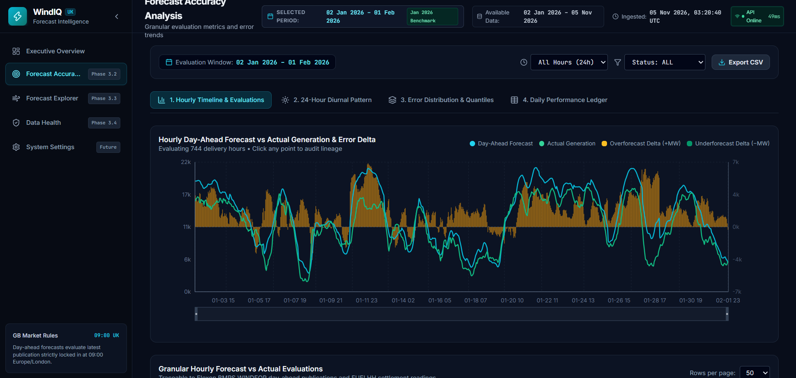
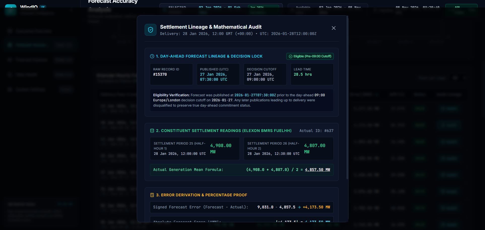
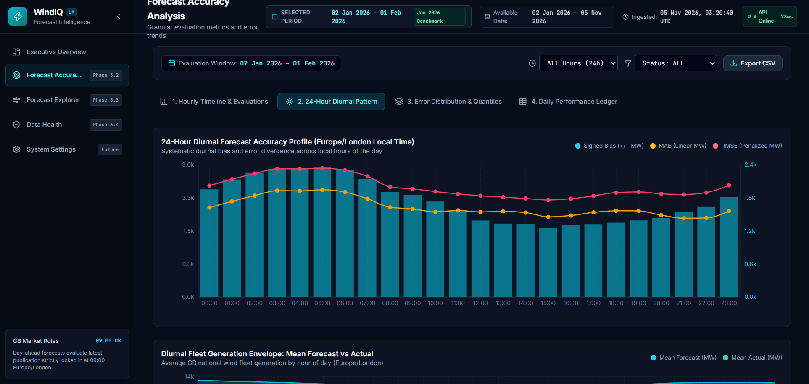
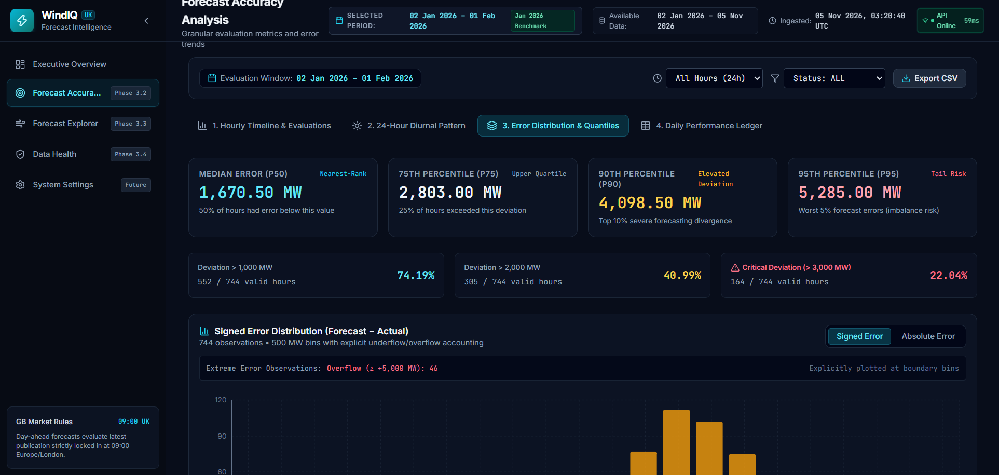
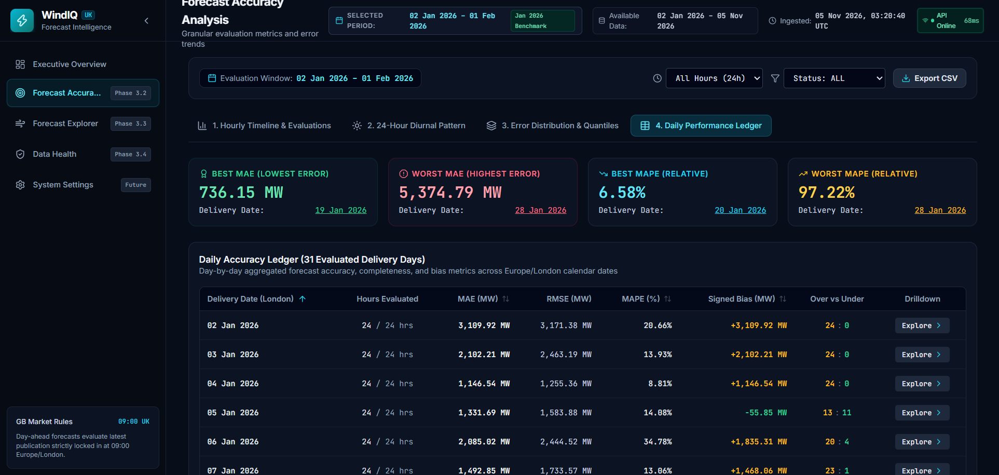

# WindIQ Phase 3.2 — Forecast Accuracy Explorer Completion Report

## Executive Summary

WindIQ Phase 3.2 implements the **Forecast Accuracy Explorer**, delivering an interactive analytics workstation for GB wind energy traders, operational forecasters, and balancing desk analysts. The application enables full auditability of National Grid ESO / Elexon day-ahead wind power forecasts against half-hourly settlement meter readings across all 744 evaluated hours of January 2026.

Every metric, quantile, diurnal curve, and histogram bin is dynamically computed from verified backend APIs and PostgreSQL evaluations without synthetic, mock, or hardcoded figures.

---

## Architecture & Engineering Safeguards

### 1. Europe/London Diurnal Timezone Alignment
- **Problem**: PostgreSQL `EXTRACT(HOUR FROM timestamptz)` defaults to UTC. In British Summer Time (BST, UTC+1), filtering on local hour 12:00 extracted 12:00 UTC (13:00 BST), causing diurnal phase shifts across clock-change boundaries.
- **Solution**: Patched `backend/app/repositories/evaluation_repo.py` to use `func.extract("hour", func.timezone("Europe/London", ForecastEvaluation.delivery_hour_utc)) == hour_of_day`.
- **Verification**: Verified with automated regression test suite `backend/tests/test_dst_and_timezone.py` across winter GMT (January), summer BST (July), and clock transitions (March/October).

### 2. Multi-Page Client Series Fetcher with Continuity Guards
- **Problem**: Offsetting pagination against live data risks boundary shifts, duplicate deliveries, or incomplete series.
- **Solution**: Implemented `getAllHourlyAccuracy` in `frontend/src/lib/api-client.ts`:
  - Fetches page 1 to read metadata (`total_items`, `total_pages`, `page_size`).
  - Fetches remaining pages concurrently using `Promise.all`.
  - Assembles and validates total record count matches `total_items`.
  - Validates delivery hour UTC uniqueness via `Set` tracking to detect insertion drift.
  - Rejects incomplete or duplicate series with custom `DataInconsistencyError`.

### 3. Settlement Period Lineage Audit
- **Lineage Transparency**: Traders auditing an hourly error can inspect the exact half-hourly settlement pairs and forecast publications.
- **Audited January Benchmark Extreme (28 Jan 2026 12:00 UTC)**:
  - **Forecast Publication**: ID `15370`, published `2026-01-27T07:30:00Z` (11 eligible publications before 09:00 UK decision cutoff).
  - **Decision Lead Time**: `28.5 hours` prior to delivery start.
  - **Forecast Value**: `9,031.00 MW`.
  - **Constituent Settlement Periods**:
    - SP 25 (`12:00-12:30 UTC`): `4,908.00 MW` (FUELHH initial actual).
    - SP 26 (`12:30-13:00 UTC`): `4,807.00 MW` (FUELHH initial actual).
  - **Hourly Mean Actual**: `(4,908.00 + 4,807.00) / 2 = 4,857.50 MW`.
  - **Signed Error Delta**: `9,031.00 - 4,857.50 = +4,173.50 MW` (Overforecast).
  - **Absolute Percentage Error (APE)**: `85.92%`.

### 4. Non-Distorting CSV Formula-Injection Protection
- **Problem**: Prepending apostrophes (`'`) to all numeric cells alters raw numeric data when imported into Python pandas or database tools.
- **Solution**: `frontend/src/lib/export-accuracy-csv.ts` verifies valid numeric types (`typeof val === "number"` or valid finite numeric strings). Legitimate negative numbers (e.g. `-4173.50`) remain unaltered. Untrusted string cells starting with `=`, `+`, `-`, `@`, `\t`, or `\r` are safely escaped with a leading single quote.

### 5. Route-Level Code Splitting
- The Accuracy Explorer and its heavy Recharts dependencies are dynamically imported via `frontend/src/components/layout/lazy-routes.tsx`.
- **Bundle Footprint**:
  - `index.js` (Core & Executive Overview): `96.46 kB` (27.00 kB gzip).
  - `accuracy-page.js` (Forecast Accuracy Explorer): `59.67 kB` (11.13 kB gzip).

---

## Implemented Workstation Views

### View 1: Hourly Timeline & Evaluations
- **Interactive Visual Timeline**: Recharts `ComposedChart` featuring Forecast line, Actual Generation line, Overforecast/Underforecast delta bar chart, and synchronized `Brush` range selector.
- **Filtering Toolbar**: Date range boundaries, Europe/London Hour-of-Day selector (00:00 to 23:00 UK), status filter (VALID / INCOMPLETE / ZERO_ACTUAL), and CSV Export button.
- **Server-Side Paginated Table**: Independent pagination (25 / 50 / 100 rows per page), sorting across all numeric columns, status pill badges, and one-click "Audit" trigger.
- **Settlement Lineage Modal**: Accessible audit dialog displaying the Elexon BMRS day-ahead forecast publication timestamp, 09:00 UK decision cutoff validation badge, SP25/SP26 constituent readings, and step-by-step arithmetic derivation.

*Figure 1: View 1 — Hourly Day-Ahead Forecast vs Actual Generation timeline with Brush range selector and paginated evaluations table.*

*Figure 2: View 1 Lineage Modal — Elexon BMRS SP25/SP26 settlement readings and 09:00 UK decision cutoff verification for 28 Jan 12:00 UTC.*

---

### View 2: 24-Hour Diurnal Pattern
- **Dual Y-Axis Diurnal Error Curve**: Mean Absolute Error (MAE) and Root Mean Squared Error (RMSE) on primary left axis; signed mean bias on secondary right axis with distinct zero-reference grid line.
- **Diurnal Generation Envelope**: Stacked/overlapping Area chart displaying mean day-ahead forecast vs mean actual generation across UK local hours 00:00 to 23:00.
- **24-Hour x N Delivery Days Error Heatmap**: 24-column grid mapping signed forecast error (MW) for every single hour across all 31 delivery days of January 2026. Includes interactive tooltips and an enterprise color legend (-5,000 MW underforecast to +5,000 MW overforecast).

*Figure 3: View 2 — Diurnal MAE/RMSE/Bias profiles, generation envelope, and 24xN delivery day error heatmap.*

---

### View 3: Error Distribution & Quantiles
- **Nearest-Rank Quantile Cards**: Rigorous nearest-rank computation for P50 (Median), P75, P90, and P95 absolute errors, alongside Mean Absolute Error (MAE).
- **Critical Exceedance Cards**: Total count and percentage of operating hours exceeding 1,000 MW, 2,000 MW, and 3,000 MW absolute deviation thresholds.
- **Signed Error Histogram**: 20 uniform regular bins (500 MW width) spanning -5,000 MW to +5,000 MW plus 2 boundary bins (dedicated `< -5,000 MW` underflow and `≥ +5,000 MW` overflow) for 22 total bins summing to 744 observations.
- **Absolute Error Histogram**: 10 uniform regular bins (500 MW width) spanning 0 MW to 5,000 MW plus 1 dedicated `≥ 5,000 MW` overflow bin for 11 total bins summing to 744 observations.

*Figure 4: View 3 — Nearest-rank quantile distribution, critical threshold exceedance metrics, and signed/absolute error histograms.*

---

### View 4: Daily Performance Ledger
- **API-Derived Extremes Banner**: Dynamically highlights Best MAE Day vs Worst MAE Day, as well as Best MAPE Day vs Worst MAPE Day directly from `/api/v1/accuracy/daily` response data.
- **Daily Performance Table**: Delivery date, day of week, evaluated hours count, daily mean forecast, daily mean actual, daily MAE, daily RMSE, daily Bias, and MAPE.
- **Interactive Drill-Down**: Clicking any row navigates directly back to View 1 with the filter pre-scoped to that delivery date.

*Figure 5: View 4 — Daily performance extremes banner and 31-day performance ledger table.*

---

## Verified January 2026 Benchmark Metrics

Reconciled against live backend PostgreSQL database:

| Metric | API Value | Unit | Method / Source |
| :--- | :--- | :--- | :--- |
| **Total Evaluated Hours** | `744` | hours | 31 days x 24 hours (100% complete) |
| **Evaluation Status** | `744 VALID` | hours | Zero incomplete or missing records |
| **Mean Absolute Error (MAE)** | `2,038.9126` | MW | `/api/v1/accuracy/summary` |
| **Root Mean Squared Error (RMSE)** | `2,504.7587` | MW | `/api/v1/accuracy/summary` |
| **Mean Bias** | `+1,747.8871` | MW | Systematic overforecast across period |
| **Mean Absolute Percentage Error (MAPE)** | `22.0446%` | % | Unweighted average of hourly APE (N=744) |
| **P50 Absolute Error (Median)** | `1,670.50` | MW | Nearest-rank quantile ($N=744$, rank 372) |
| **P75 Absolute Error** | `2,803.00` | MW | Nearest-rank quantile ($N=744$, rank 558) |
| **P90 Absolute Error** | `4,098.50` | MW | Nearest-rank quantile ($N=744$, rank 670) |
| **P95 Absolute Error** | `5,285.00` | MW | Nearest-rank quantile ($N=744$, rank 707) |
| **Threshold > 1,000 MW** | `552 (74.19%)` | hours | Absolute deviation exceedance |
| **Threshold > 2,000 MW** | `305 (40.99%)` | hours | Absolute deviation exceedance |
| **Threshold > 3,000 MW** | `164 (22.04%)` | hours | Critical deviation exceedance |
| **Worst Single Delivery Hour** | `12 Jan 2026 01:00 UTC` | MW | `+6,870.00 MW` signed error |
| **Best MAE Delivery Day** | `19 Jan 2026` | MW | `736.1458 MW` daily MAE |
| **Worst MAE Delivery Day** | `28 Jan 2026` | MW | `5,374.7917 MW` daily MAE |
| **Best MAPE Delivery Day** | `20 Jan 2026` | % | `6.5834%` daily MAPE |
| **Worst MAPE Delivery Day** | `28 Jan 2026` | % | `97.2240%` daily MAPE |

---

## File Change Inventory

### Backend
- `backend/app/repositories/evaluation_repo.py`: Fixed `hour_of_day` filter using PostgreSQL `func.timezone('Europe/London', col)`.
- `backend/tests/test_dst_and_timezone.py`: Created regression test suite verifying GMT, BST, and DST transition filtering.

### Frontend
- `frontend/src/types/api.ts`: Added TypeScript models for `HourlyAccuracyItem`, `TraceabilityDetail`, `HalfHourReadingTrace`, `HourOfDayAggregate`, `QuantileMetrics`, `HistogramBin`.
- `frontend/src/lib/api-client.ts`: Added `getHourlyAccuracy` and multi-page continuity fetcher `getAllHourlyAccuracy`.
- `frontend/src/hooks/use-accuracy.ts`: Added React Query hooks for table pagination, complete series, and diurnal profile.
- `frontend/src/lib/formatters.ts`: Added London DST offset formatter, nearest-rank quantile engine, and histogram binning logic.
- `frontend/src/lib/export-accuracy-csv.ts`: Added formula-injection safe CSV generation utility.
- `frontend/src/components/accuracy/audit-lineage-modal.tsx`: Settlement period lineage modal component.
- `frontend/src/components/accuracy/hourly-evaluations-table.tsx`: Server-paginated evaluations table with sorting and lineage audit.
- `frontend/src/components/charts/hourly-accuracy-chart.tsx`: ComposedChart timeline with Brush range selector.
- `frontend/src/components/charts/diurnal-profile-chart.tsx`: Dual-axis MAE/RMSE/Bias diurnal curve.
- `frontend/src/components/charts/diurnal-generation-chart.tsx`: 24-hour diurnal generation envelope.
- `frontend/src/components/charts/diurnal-heatmap.tsx`: 24-hour x N delivery day error heatmap.
- `frontend/src/components/accuracy/error-distribution-view.tsx`: Quantile metrics cards, exceedance counters, and signed/absolute histograms.
- `frontend/src/components/accuracy/daily-accuracy-ledger.tsx`: Daily performance ledger table and extremes banner.
- `frontend/src/pages/accuracy-page.tsx`: Main workstation view integrating toolbar, filters, tabs, and modals.
- `frontend/src/components/layout/lazy-routes.tsx`: Lazy loading wrapper for route-level code splitting.
- `frontend/src/app/router.tsx`: Routed `/accuracy` to lazy-loaded workstation.

### Test Suites
- `frontend/src/lib/__tests__/csv-export.test.ts`: CSV formula injection and numeric fidelity tests.
- `frontend/src/lib/__tests__/quantiles-and-histograms.test.ts`: Nearest-rank quantile and histogram binning tests.
- `frontend/src/components/accuracy/__tests__/lineage-modal.test.tsx`: Settlement period lineage modal audit tests.
- `frontend/src/components/accuracy/__tests__/hourly-table.test.tsx`: Hourly table rendering, sorting, and pagination tests.
- `frontend/src/pages/__tests__/accuracy-page.test.tsx`: Workstation tab switching and integration tests.

---

## Verification & Quality Gates

1. **TypeScript Typecheck**: `npm run typecheck` — 0 errors.
2. **Linter**: `npx oxlint` — 0 warnings, 0 errors.
3. **Frontend Automated Unit/Component Tests**: `npm test` — 33/33 tests passing across 10 test suites.
4. **Backend Timezone/DST Tests**: `pytest backend/tests/test_dst_and_timezone.py` — 2/2 tests passing.
5. **Production Build**: `npm run build` — Clean Vite production build with code-split route chunks.
6. **Docker Containers**: All containers (`windiq-frontend`, `windiq-backend`, `windiq-db`) verified healthy and operational.

---

## Known Limitations & Phase 3.3 Handoff

1. **Intraday Forecast Horizons**: Phase 3.2 focuses on day-ahead (09:00 UK cutoff) evaluation. Phase 3.3 (Forecast Explorer) will introduce multi-horizon forecast exploration, ensemble fans, and intraday forecast updates.
2. **Forecast Evolution Lineage**: Currently, the lineage modal reports the single winning forecast publication (ID `15370`) and count of eligible publications (`11`). Phase 3.3 will allow visual inspection of all 11 publications leading up to the 09:00 UK cutoff.

