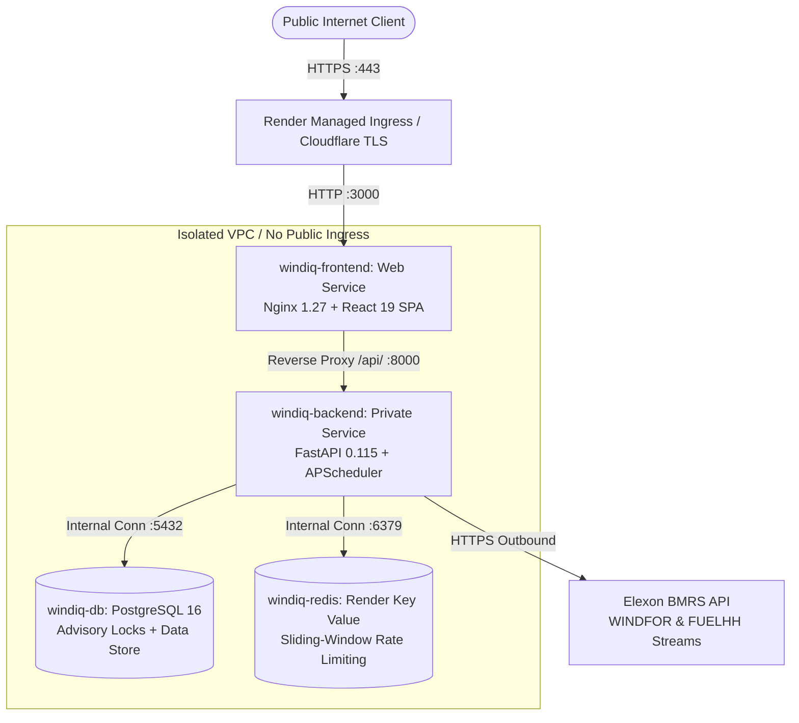

# WindIQ — Production Deployment Guide on Render

**Document Identifier**: [`docs/render_deployment_guide.md`](file:///c:/Users/prana/Projects/WindIQ/docs/render_deployment_guide.md)  
**Author**: DevOps, Security & Release Engineering  
**Version**: 2.2.0-rc1  
**Target Platform**: [Render Cloud Infrastructure](https://render.com)  
**Target Architecture**: Docker Web Service + Docker Private Service + Managed PostgreSQL 16 + Managed Redis/Key Value  

---

## 1. Production Architecture Overview

WindIQ uses a secure, unified single-origin topology. All public incoming traffic enters through Render's managed HTTPS ingress directly to the **Frontend Web Service** (running Nginx 1.27 + React 19). The frontend serves compiled static assets and reverse-proxies `/api/` and `/health/` requests directly to the **Backend Private Service** across Render's internal private network.



### Architectural Security Advantages
1. **Zero Public Exposure for Backend & Data**: Neither the PostgreSQL database, Redis store, nor FastAPI backend are exposed to the public internet. All inter-service communication is strictly confined to Render's private network.
2. **Unified Same-Origin Browser Context**: The browser interacts exclusively with `https://<render-subdomain>.onrender.com`. Cookies (`windiq_refresh_token` and `windiq_csrf_token`) operate in a strict first-party same-origin context.
3. **Continuous Background Scheduler**: The FastAPI application hosts an `AsyncIOScheduler` background process guarded by a 64-bit PostgreSQL cluster advisory lock (`pg_try_advisory_lock`), ensuring automated rolling ingestion runs without interruption.

---

## 2. Infrastructure Pricing & Cost Estimation

Render services are billed by the second while active and can be cancelled or paused at any time.

### Option 1: Minimum Sensible Production (Recommended for Recruiter Demo)
*Zero sleep, persistent compute, 24/7 background scheduler, zero cold-start delay.*

| Resource | Service Name | Render Type | Plan / Tier | Specs | Monthly Cost |
|---|---|---|---|---|---:|
| **Workspace Platform** | WindIQ Team | Workspace | Hobby | 1 user, 25 services, 5 GB egress | **$0.00** |
| **Frontend Proxy** | `windiq-frontend` | Web Service | Starter | 512 MB RAM, 0.5 CPU, 24/7 active | **$7.00** |
| **Backend API Engine** | `windiq-backend` | Private Service | Starter | 512 MB RAM, 0.5 CPU, persistent | **$7.00** |
| **Relational Database** | `windiq-db` | PostgreSQL | Starter | 1 GB RAM, 25 GB storage, backups | **$7.00** |
| **Coordination Store** | `windiq-redis` | Key Value | Starter | 256 MB RAM, volatile-lru eviction | **$10.00** |
| **Internal Data Transfer**| Same-Region VPC | Network | Included | Frankfurt intra-VPC bandwidth | **$0.00** |
| **Total Estimated Cost** | | | | | **~$31.00 / mo** |

> [!NOTE]
> Since Render bills per second, running this environment for a 48-hour evaluation or demonstration costs **approximately $1.00 to $2.00 total**.

### Option 2: Cost-Optimized Demonstration Configuration
*Utilizes Render free-tier components where permissible.*

| Resource | Service Name | Plan / Tier | Limitation / Behavior | Monthly Cost |
|---|---|---|---|---:|
| **Workspace Platform** | WindIQ Team | Hobby | 1 seat | **$0.00** |
| **Frontend Web** | `windiq-frontend` | Free | Spins down after 15m inactivity (~50s cold start) | **$0.00** |
| **Backend Engine** | `windiq-backend` | Starter | Must be Starter ($7/mo); private services have no free tier | **$7.00** |
| **PostgreSQL** | `windiq-db` | Free | Automatically deleted after 30 days (1 GB storage) | **$0.00** |
| **Key Value / Redis** | `windiq-redis` | Free | 25 MB RAM limit, in-memory cache | **$0.00** |
| **Total Estimated Cost** | | | | **~$7.00 / mo** |

---

## 3. Step-by-Step Render Deployment Process

### Step 1: Connect Git Repository to Render
1. Ensure commit `ebc1357` is pushed to your GitHub repository:
   ```bash
   git push origin main
   ```
2. Log in to the [Render Dashboard](https://dashboard.render.com).
3. Click **New +** in the top navigation and select **Blueprint**.
4. Connect your GitHub account and select the **WindIQ** repository.

### Step 2: Review Blueprint (`render.yaml`)
Render will automatically detect [`render.yaml`](file:///c:/Users/prana/Projects/WindIQ/render.yaml) at the repository root and display the 4 declared resources:
1. `windiq-db` (PostgreSQL Database)
2. `windiq-redis` (Key Value Store)
3. `windiq-backend` (Private Service)
4. `windiq-frontend` (Web Service)

Select the target region (Recommended: **Frankfurt, Germany** for low-latency European power market alignment).

### Step 3: Approve & Launch Blueprint
Click **Apply Blueprint**. Render will provision the managed database and Redis instances first, then build and launch the containerized backend and frontend services.

---

## 4. Production Environment Checklist & Secret Management

All sensitive secrets are automatically generated by Render via `generateValue: true` in `render.yaml` or can be configured manually via the Render Dashboard.

| Variable | Target Service | Generated By | Production Requirement |
|---|---|---|---|
| `APP_ENV` | `windiq-backend` | Hardcoded | Must be `production` |
| `DEBUG` | `windiq-backend` | Hardcoded | Must be `false` |
| `DATABASE_URL` | `windiq-backend` | Render `fromDatabase` | Automatically injected internal PostgreSQL connection string |
| `REDIS_URL` | `windiq-backend` | Render `fromService` | Automatically injected internal Redis connection string |
| `JWT_SECRET_KEY` | `windiq-backend` | Render `generateValue` | Minimum 32 bytes high-entropy random string |
| `CSRF_SECRET_KEY`| `windiq-backend` | Render `generateValue` | High-entropy random string |
| `AUTH_COOKIE_SECURE`| `windiq-backend`| Hardcoded | Must be `true` |
| `AUTH_COOKIE_SAMESITE`| `windiq-backend`| Hardcoded | `lax` |
| `TRUSTED_PROXIES`| `windiq-backend`| Hardcoded | `10.0.0.0/8,172.16.0.0/12,127.0.0.1/32,::1/128` |
| `BACKEND_HOST` | `windiq-frontend` | Render `fromService` | Resolves to `windiq-backend` |
| `BACKEND_PORT` | `windiq-frontend` | Render `fromService` | `8000` |

### Manual Secret Generation (If configuring outside Blueprint)
If you configure environment variables manually in the dashboard, generate cryptographically random keys locally:
```bash
# JWT Secret Key
openssl rand -hex 32

# CSRF Secret Key
openssl rand -hex 32
```

---

## 5. Production Benchmark Initialization Runbook

When the database is newly provisioned, it is empty. To execute schema migrations, seed default roles, and verify the canonical January 2026 benchmark:

### Execution via Render Dashboard Shell
1. In the Render Dashboard, navigate to the **`windiq-backend`** private service.
2. Click the **Shell** tab to open an interactive terminal.
3. Run the automated initialization command:
   ```bash
   python scripts/init_production_benchmark.py
   ```

### What This Script Executes
1. **Alembic Migrations**: Applies all database schema revisions up to `005_auth_and_rbac_schema`.
2. **Account Seeding**: Provisions default demonstration accounts (`Admin`, `Analyst`, `Viewer`) with secure Argon2id hashes.
3. **Dataset Ingestion**: Idempotently ingests 18,104 WINDFOR records and 1,488 FUELHH settlement readings from the verified canonical repository assets.
4. **Day-Ahead Evaluation**: Computes the 744 hourly evaluations adhering strictly to the 09:00 UK day-ahead decision cutoff.
5. **Mathematical Verification**: Executes automated SQL checks asserting that all 11 benchmark KPIs match the canonical ground truth to 4 decimal places.

### Expected Output
```text
================================================================================
WINDIQ CANONICAL JANUARY 2026 BENCHMARK RECONCILIATION
================================================================================
Metric                         | Expected        | Actual          | Delta      | Status
--------------------------------------------------------------------------------
count                          | 744             | 744             | 0.0000     | PASS
mae                            | 2038.9126       | 2038.9126       | 0.0000     | PASS
rmse                           | 2504.7587       | 2504.7587       | 0.0000     | PASS
mape                           | 22.0446         | 22.0446         | 0.0000     | PASS
bias                           | 1747.8871       | 1747.8871       | 0.0000     | PASS
overforecast                   | 632             | 632             | 0.0000     | PASS
underforecast                  | 112             | 112             | 0.0000     | PASS
matched_population             | 553             | 553             | 0.0000     | PASS
matched_mae_reduction          | 34.16           | 34.16           | 0.0000     | PASS
forward_revisions              | 13367           | 13367           | 0.0000     | PASS
mean_abs_revision              | 343.9565        | 343.9565        | 0.0000     | PASS
================================================================================
ALL 11 BENCHMARK METRICS VERIFIED AND RECONCILED (100% MATCH).
```

---

## 6. Public Smoke Testing & Verification Checklist

Once the services are deployed and initialized, test the live public URL (`https://<frontend-service>.onrender.com`):

| # | Test Item | Verification Method | Expected Result |
|---|---|---|---|
| 1 | **Frontend Availability** | Open `https://<frontend>.onrender.com/` | HTTP 200 OK, SPA renders cleanly |
| 2 | **Nginx Health Check** | `GET /healthz` | HTTP 200 OK (`OK`) |
| 3 | **Backend Liveness** | `GET /health/live` | HTTP 200 OK (`{"status":"alive"}`) |
| 4 | **Backend Readiness** | `GET /health/ready` | HTTP 200 OK (`db: connected, redis: connected`) |
| 5 | **Analyst Login** | Click top-right demo switcher -> Analyst | Successful sign-in, token stored in memory |
| 6 | **F5 Session Restoration** | Press browser reload (F5) on `/` | Silent session refresh via `/api/v1/auth/refresh`; zero 401 banners |
| 7 | **Accuracy Explorer** | Navigate to `/accuracy` | 744h timeline, zoom brush, 50-row pagination |
| 8 | **Settlement Lineage Modal**| Click any row in accuracy table | Modal displays both 30-min FUELHH readings |
| 9 | **Forecast Explorer** | Navigate to `/forecasts` | 4 views render: Evolution, Horizons, Revisions, Timeline |
| 10| **Benchmark Match** | Compare Overview KPI cards | MAE 2,038.91 MW, Bias +1,747.89 MW, MAPE 22.04% |
| 11| **Sign Out** | Click Sign Out | Refresh & CSRF cookies cleared, returns to unauthenticated |

---

## 7. Operational Runbook & Troubleshooting

### Scenario A: Backend Fails to Start
* **Check**: Inspect `windiq-backend` deployment logs.
* **Common Cause**: Database migration pending or invalid `DATABASE_URL`.
* **Fix**: Ensure `windiq-db` is marked Healthy. Verify `backend/app/core/config.py` normalizes `postgres://` to `postgresql+asyncpg://`.

### Scenario B: Nginx Returns HTTP 502 Bad Gateway
* **Check**: Inspect `windiq-frontend` logs.
* **Common Cause**: `BACKEND_HOST` environment variable unresolved or backend is still booting.
* **Fix**: Confirm `windiq-backend` is listening on port 8000 and internal networking alias matches `windiq-backend`.

### Scenario C: Redis Outage (Fail-Closed Triggered)
* **Behavior**: Sensitive mutation endpoints (login, refresh, API key creation) reject requests with HTTP 503.
* **Check**: Test Redis ping via `/health/ready`.
* **Fix**: Restart `windiq-redis` service from the Render dashboard.

### Scenario D: Background Scheduler Recovery
* **Verification**: `windiq-backend` logs show:
  ```text
  [INFO] WindIQScheduler started successfully
  [INFO] Acquired cluster leader lock (id=24566378415277825)
  ```
* **Recovery**: If the container restarts, the PostgreSQL advisory lock is automatically released upon TCP termination, and the new instance immediately re-acquires leadership.
